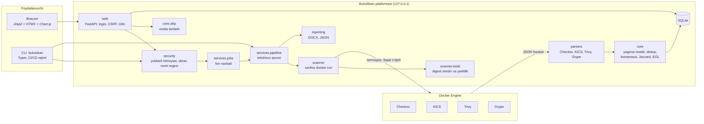
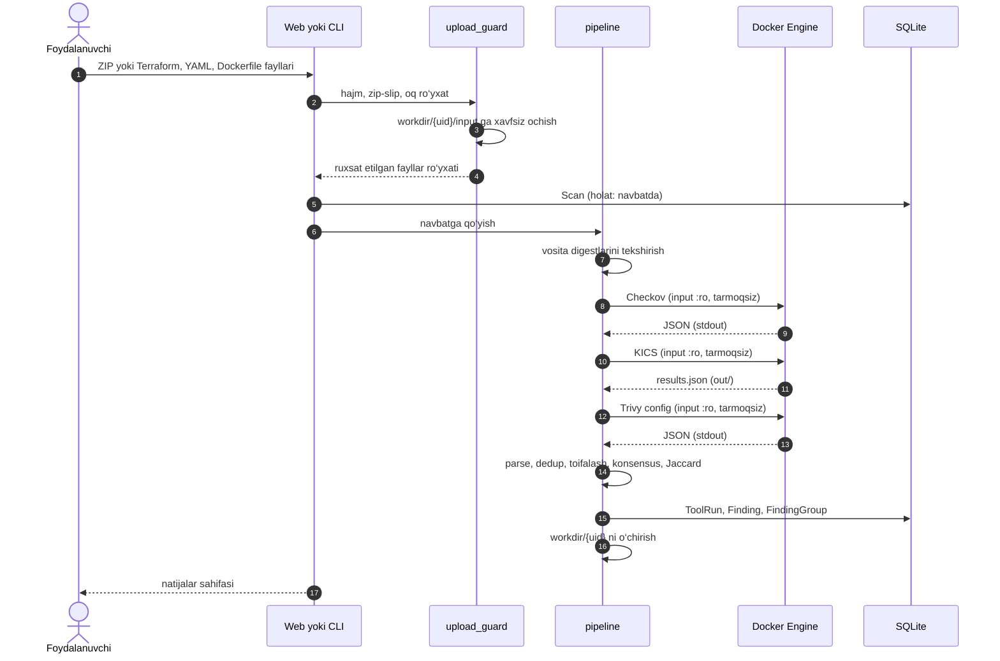
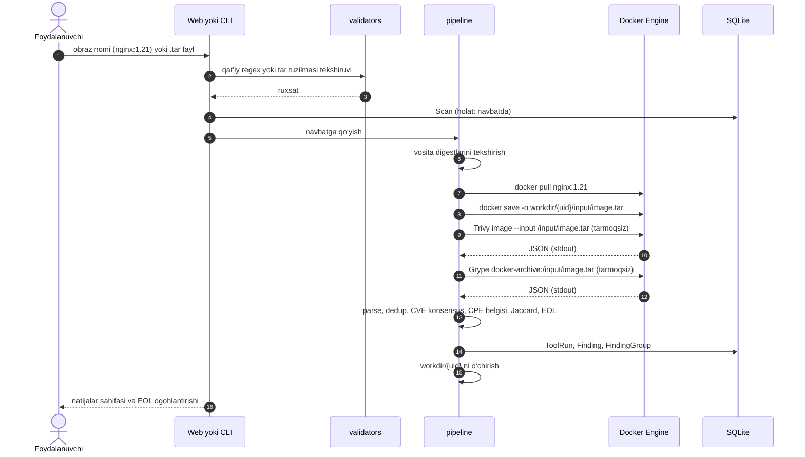
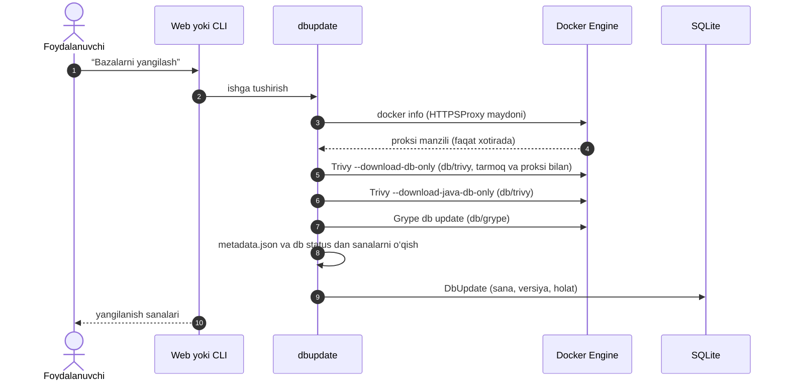
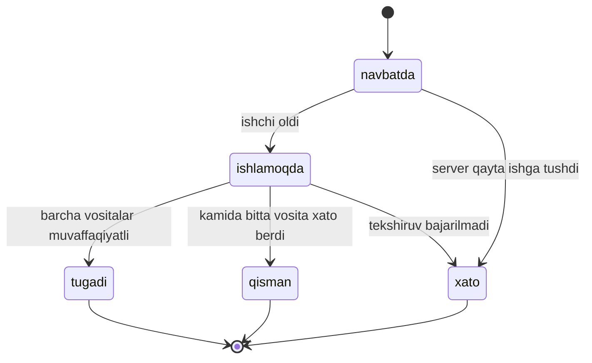
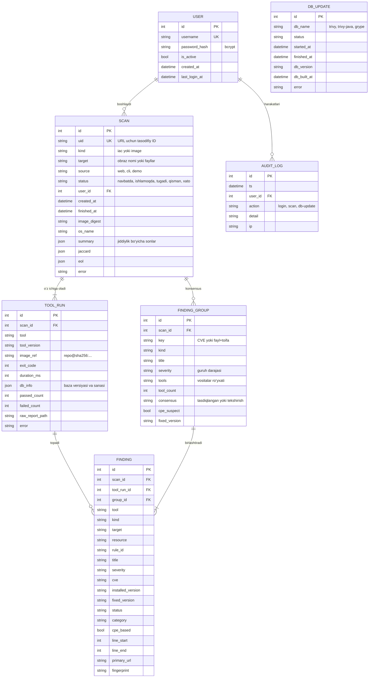

# BulutSkan arxitekturasi

> **Holat:** 1-bosqich, loyiha rejasi. Kod hali yozilmagan.
> ⚠ belgisi qo‘yilgan joylar `Sinov` papkasidagi materiallarga (`analyze.py`, `stats3.py`, `ground_truth.csv`, `config.ps1`, `tool_digests.txt`) bog‘liq. Ular o‘qib chiqilgach, bu joylar aniqlashtiriladi.

BulutSkan — bulutli infratuzilma kodini (IaC) va konteyner obrazlarini bir nechta ochiq kodli skaner bilan tekshiradigan mahalliy veb-platforma. U Andijon davlat universiteti magistranti Odilova Robiyaxonning “Bulutli hisoblash texnologiyalari xavfsizligini ta’minlovchi dasturiy vositalarni qiyosiy tahlil qilish va ochiq kodli vositalar samaradorligini baholash” mavzusidagi dissertatsiyasining amaliy natijasidir.

## 1. Asosiy tamoyillar

Platformaning har bir qismi dissertatsiya xulosalaridan kelib chiqadigan beshta tamoyilga bo‘ysunadi:

1. **Bitta skanerga ishonilmaydi.** Har bir obyekt kamida ikkita vosita bilan tekshiriladi. Natijalar konsensus va Jaccard koeffitsienti orqali taqqoslanadi.
2. **Skaner — ishonchsiz kod.** Har bir vosita alohida, tarmoqsiz, imtiyozsiz va resurslari cheklangan konteynerda ishlaydi.
3. **Ta’minot zanjiri qotiriladi.** Vositalar teg orqali emas, faqat sha256 digest orqali chaqiriladi. Digest mos kelmasa, tekshiruv boshlanmaydi.
4. **Internet faqat bitta bosqichda kerak.** Zaifliklar bazalari alohida “bazalarni yangilash” amali bilan yuklanadi. Tekshiruvning o‘zi internetsiz bajariladi.
5. **Ma’lumotlar mahalliy qoladi.** Telemetriya, tashqi CDN va tashqi API yo‘q. Ilova sukut bo‘yicha faqat `127.0.0.1` manzilida tinglaydi.

## 2. Umumiy ko‘rinish



Veb-interfeys va CLI bir xil `services.pipeline` quvurini chaqiradi. Shu sababli brauzer va CI/CD bir xil natija beradi.

## 3. Modullar

| Modul | Vazifasi | Bosqich |
|---|---|---|
| `bulutskan.config` | `.env` faylidan sozlamalarni o‘qish (pydantic-settings), kataloglar va limitlar | 2 |
| `bulutskan.core.models` | Yagona topilma modeli, jiddiylik va holat sanoqlari (enum) | 2 |
| `bulutskan.core.normalize` | Jiddiylik va holatni normallashtirish, GHSA → CVE (`stats3.py` asosida) | 2 |
| `bulutskan.core.dedup` | Bitta vosita ichidagi takroriy topilmalarni birlashtirish | 2 |
| `bulutskan.core.categories` | IaC xato toifalari: `ground_truth.csv` dagi regex qoidalari | 2 |
| `bulutskan.core.consensus` | Vositalararo guruhlash, “Tasdiqlangan” va boshqa belgilar, Jaccard | 2 |
| `bulutskan.core.eol` | Eskirgan bazaviy obrazni aniqlash | 2 |
| `bulutskan.core.ahp` | AHP vaznlari, ballar, ssenariylar, reyting | 2 |
| `bulutskan.parsers.*` | Checkov, KICS, Trivy (image va config), Grype JSON parserlari (`analyze.py` asosida) | 2 |
| `bulutskan.scanner.docker` | `docker` buyrug‘ini argumentlar ro‘yxati sifatida qurish va ishga tushirish | 3 |
| `bulutskan.scanner.tools` | Vositalar reestri, digest yaxlitligini tekshirish | 3 |
| `bulutskan.scanner.iac`, `.image` | IaC va obraz tekshiruvi ssenariylari | 3 |
| `bulutskan.scanner.dbupdate` | Trivy, Trivy Java va Grype bazalarini yangilash | 3 |
| `bulutskan.security.*` | Yuklash himoyasi, vaqtinchalik katalog, obraz nomi regexi, bcrypt | 3–4 |
| `bulutskan.storage.*` | SQLAlchemy jadvallari va so‘rovlar | 3 |
| `bulutskan.services.*` | Tekshiruv quvuri, fon navbati, solishtirish, demo-import | 3–7 |
| `bulutskan.web.*` | FastAPI ilovasi, marshrutlar, shablonlar, statik fayllar | 4 |
| `bulutskan.reporting.*` | DOCX hisobot va JSON eksport | 5 |
| `bulutskan.cli` | Typer buyruqlari | 5, 7 |

Kodda identifikatorlar ingliz tilida, izohlar va docstring’lar o‘zbek tilida yoziladi. Barcha funksiyalarda tur izohlari (type hints) bo‘ladi.

## 4. Papkalar tuzilmasi

Repozitoriy ildizi — `BulutSkan` loyihasining o‘zi. Windows’da u `D:\Dissertatsiyaga oid\Robiyaxon\BulutSkan` papkasiga klon qilinadi.

```text
BulutSkan/
├── bulutskan/
│   ├── __init__.py              # versiya
│   ├── __main__.py              # python -m bulutskan
│   ├── config.py                # Settings (.env)
│   ├── cli.py                   # Typer: scan, db-update, tools, demo-import, user, serve
│   ├── core/
│   │   ├── models.py            # Finding, Severity, FindingStatus, ToolReport, ScanResult
│   │   ├── normalize.py         # jiddiylik, holat, CVE normallashtirish
│   │   ├── dedup.py             # takrorlarni birlashtirish
│   │   ├── categories.py        # IaC toifalari (ground_truth.csv)
│   │   ├── consensus.py         # konsensus guruhlari, Jaccard
│   │   ├── eol.py               # EOL aniqlash
│   │   └── ahp.py               # AHP
│   ├── parsers/
│   │   ├── base.py              # umumiy interfeys, JSON ni xavfsiz o‘qish
│   │   ├── checkov.py
│   │   ├── kics.py
│   │   ├── trivy.py             # image (zaiflik) va config (noto‘g‘ri sozlama)
│   │   └── grype.py
│   ├── scanner/
│   │   ├── docker.py            # xavfsiz docker argumentlari, subprocess, timeout
│   │   ├── tools.py             # reestr va digest tekshiruvi
│   │   ├── iac.py
│   │   ├── image.py             # pull → save → internetsiz skan
│   │   └── dbupdate.py          # bazalarni yangilash, proksini aniqlash
│   ├── security/
│   │   ├── upload_guard.py      # hajm, zip-slip, oq ro‘yxat, tar tekshiruvi
│   │   ├── workspace.py         # tekshiruv uchun vaqtinchalik katalog
│   │   ├── validators.py        # obraz nomi regexi
│   │   └── passwords.py         # bcrypt
│   ├── storage/
│   │   ├── db.py                # engine, sessiya
│   │   ├── tables.py            # ORM jadvallari
│   │   └── repo.py              # saqlash va o‘qish
│   ├── services/
│   │   ├── pipeline.py          # parse → dedup → konsensus → EOL → saqlash
│   │   ├── jobs.py              # fon navbati
│   │   ├── compare.py           # ikki tekshiruvni solishtirish
│   │   └── demo.py              # demo-import
│   ├── reporting/
│   │   ├── docx_report.py
│   │   └── json_export.py
│   ├── resources/
│   │   ├── tool_digests.txt     # Sinov\natijalar dan nusxa
│   │   ├── checkov.Dockerfile   # Sinov dan nusxa
│   │   ├── ground_truth.csv     # Sinov dan nusxa
│   │   └── eol.json             # ichki EOL ro‘yxati
│   └── web/
│       ├── app.py               # FastAPI fabrikasi, middleware’lar
│       ├── auth.py              # login, sessiya, urinishlar cheklovi
│       ├── csrf.py
│       ├── i18n.py
│       ├── i18n/uz.json, en.json
│       ├── routes/              # dashboard, iac, image, scans, compare, ahp, tools
│       ├── templates/           # base.html, sahifalar, partials/
│       └── static/              # css/, js/, icons/, vendor/ (htmx, Chart.js)
├── demo/iac/{insecure,secure}/  # Sinov\iac dan nusxa
├── tests/
│   ├── conftest.py
│   ├── fixtures/natijalar/      # Sinov\natijalar dagi real JSON hisobotlar
│   └── test_*.py
├── ci/
│   ├── github-actions.yml       # namuna
│   └── gitlab-ci.yml            # namuna
├── docs/arxitektura.md
├── pyproject.toml
├── requirements.txt
├── run.ps1
├── docker-compose.yml           # ixtiyoriy
├── .env.example
├── .gitignore
├── LICENSE                      # MIT
└── README.md
```

Ish vaqtida yaratiladigan barcha fayllar ildizdagi `data/` katalogiga tushadi va repozitoriyga kirmaydi:

```text
data/
├── bulutskan.db                 # SQLite
├── workdir/{scan_uid}/          # har tekshiruv uchun alohida, ish tugagach o‘chiriladi
│   ├── input/                   # yuklangan va ochilgan IaC fayllar yoki image.tar
│   └── out/                     # faqat KICS natija fayli uchun (7.4-bo‘limga qarang)
├── db/trivy/                    # Trivy asosiy va Java bazalari
├── db/grype/                    # Grype bazasi
└── hisobotlar/{scan_uid}/       # xom JSON hisobotlar, DOCX
```

`Sinov` papkasidagi fayllar o‘zgartirilmaydi. Kerakli fayllar repozitoriyga nusxa sifatida olinadi (`resources/`, `tests/fixtures/`, `demo/`).

## 5. Tekshiruv jarayonlari

### 5.1. IaC tekshiruvi



### 5.2. Konteyner obrazi tekshiruvi



Foydalanuvchi obrazi hech qachon `docker run` bilan ishga tushirilmaydi. U faqat yuklab olinadi va `.tar` arxivga saqlanadi. `.tar` fayl yuklanganda pull va save bosqichlari o‘tkazib yuboriladi.

Vositalar ketma-ket ishlaydi. Bir vaqtda faqat bitta skaner konteyneri ishlaydi, shuning uchun CPU va xotira limitlari kompyuterni band qilib qo‘ymaydi.

### 5.3. Bazalarni yangilash



Proksi manzili faqat shu bosqichda ishlatiladi. U faylga, bazaga va jurnalga yozilmaydi. Jurnalda faqat “proksi aniqlandi: ha/yo‘q” ko‘rinadi, chunki manzil ichida login va parol bo‘lishi mumkin.

Obrazni `docker pull` bilan yuklashda platforma proksi bermaydi. Bu ishni Docker Desktop o‘z sozlamalari bilan bajaradi.

### 5.4. Tekshiruv holatlari



“Qisman” holatida konsensus faqat ishlagan vositalar bo‘yicha hisoblanadi va natijalar sahifasida bu haqda ogohlantirish chiqadi.

## 6. Yagona topilma modeli

### 6.1. Maydonlar

Talab qilingan to‘qqizta maydonga konsensus, hisobot va solishtirish uchun kerakli yordamchi maydonlar qo‘shiladi.

| Maydon | Tur | Ma’nosi |
|---|---|---|
| `tool` | enum | Vosita: checkov, kics, trivy, grype |
| `target` | str | Fayl (IaC) yoki paket nomi (obraz) |
| `resource` | str \| None | Resurs (IaC) yoki paket joylashuvi (obraz) |
| `rule_id` | str | Qoida ID yoki zaiflik ID |
| `title` | str | Nomi |
| `severity` | enum | CRITICAL, HIGH, MEDIUM, LOW, INFO, UNKNOWN |
| `cve` | str \| None | Normallashtirilgan CVE |
| `fixed_version` | str \| None | Tuzatilgan versiya |
| `status` | enum | Holat (6.3-bo‘lim) |
| `kind` | enum | `vulnerability` yoki `misconfiguration` |
| `installed_version` | str \| None | O‘rnatilgan versiya |
| `package_type` | str \| None | deb, apk, npm, jar, binary va hokazo |
| `category` | str \| None | IaC xato toifasi (`ground_truth.csv`) |
| `cpe_based` | bool | Grype natijasi CPE yoki binar fayl orqali topilganmi |
| `line_start`, `line_end` | int \| None | IaC faylidagi qatorlar |
| `primary_url` | str \| None | Qoida yoki CVE havolasi |
| `fingerprint` | str | Takrorlarni aniqlash kaliti (6.4-bo‘lim) |

### 6.2. Manba maydonlari ⚠

Jadval vositalarning JSON tuzilmasiga asoslangan. Aniq mantiq `analyze.py` dan olinadi.

| Maydon | Checkov | KICS | Trivy config | Trivy image | Grype |
|---|---|---|---|---|---|
| `target` | `file_path` | `files[].file_name` | `Results[].Target` | `PkgName` | `artifact.name` |
| `resource` | `resource` | `files[].resource_name` / `search_key` | `CauseMetadata.Resource` | `PkgPath` yoki `Target` | `artifact.locations[].path` |
| `rule_id` | `check_id` | `query_id` | `ID` (AVD) | `VulnerabilityID` | `vulnerability.id` |
| `title` | `check_name` | `query_name` | `Title` | `Title` | `vulnerability.id` + tavsif |
| `severity` | `severity` (ko‘pincha `null`) | `severity` | `Severity` | `Severity` | `vulnerability.severity` |
| `cve` | — | — | — | `VulnerabilityID` | `id` yoki `relatedVulnerabilities[].id` |
| `fixed_version` | — | — | — | `FixedVersion` | `vulnerability.fix.versions[]` |
| `status` | `FAILED` | — | `Status` | `Status` | `vulnerability.fix.state` |
| qatorlar | `file_line_range` | `files[].line` | `CauseMetadata.StartLine/EndLine` | — | — |

### 6.3. Normallashtirish ⚠

Jiddiylik darajalari:

| Manba qiymati | Yagona qiymat |
|---|---|
| CRITICAL, Critical | CRITICAL |
| HIGH, High | HIGH |
| MEDIUM, Medium | MEDIUM |
| LOW, Low | LOW |
| Negligible (Grype) | LOW |
| INFO, TRACE (KICS) | INFO |
| `null`, Unknown, bo‘sh | UNKNOWN |

Grype’ning Negligible darajasini LOW ga tenglash Trivy bilan bir xil shkala beradi: Trivy Debian’ning “negligible” baholarini LOW sifatida ko‘rsatadi. `analyze.py` boshqacha yo‘l tutgan bo‘lsa, o‘sha mantiq olinadi.

Checkov’ning ochiq kodli versiyasi ko‘pincha `severity: null` qaytaradi. Platforma bu qiymatni to‘qib chiqarmaydi va UNKNOWN deb saqlaydi. Konsensus guruhida esa guruhning jiddiyligi a’zolarning ma’lum bo‘lgan eng yuqori darajasi bo‘ladi. Masalan, Checkov va KICS bir xatoni topsa, guruh KICS darajasini oladi. Bu daraja interfeysda “guruh bo‘yicha” deb belgilanadi.

Holat (`status`):

| Yagona qiymat | O‘zbekcha nomi | Manba |
|---|---|---|
| `fix_available` | Tuzatish mavjud | Trivy `fixed`, Grype `fixed` |
| `no_fix` | Tuzatish yo‘q | Trivy `affected`, Grype `not-fixed` |
| `wont_fix` | Tuzatilmaydi | Trivy `will_not_fix`, `fix_deferred`, Grype `wont-fix` |
| `unknown` | Noma’lum | qolgan holatlar |
| `failed` | Qoidaga zid | IaC: muvaffaqiyatsiz tekshiruvlar |

IaC bo‘yicha faqat muvaffaqiyatsiz tekshiruvlar topilma sifatida saqlanadi. O‘tgan tekshiruvlar soni `ToolRun` statistikasida qoladi.

CVE normallashtirish (`stats3.py` asosida ⚠): ID katta harfga keltiriladi. GHSA identifikatori Grype’ning `relatedVulnerabilities` ro‘yxati orqali CVE ga almashtiriladi. CVE topilmasa, GHSA o‘zi kalit bo‘lib qoladi.

### 6.4. Takrorlarni birlashtirish

Bir vosita bir topilmani bir necha marta qaytarishi mumkin. Masalan, Grype bitta paketni har bir joylashuvi uchun alohida ko‘rsatadi. Birlashtirish kaliti (`fingerprint`):

- zaiflik: `tool + cve_yoki_id + paket + o‘rnatilgan_versiya`;
- noto‘g‘ri sozlama: `tool + rule_id + fayl + resurs + boshlanish_qatori`.

Bir xil kalitli yozuvlar bitta topilmaga aylanadi, joylashuvlari esa ro‘yxat bo‘lib saqlanadi.

## 7. Konsensus mantiqi (asosiy ilmiy g‘oya)

### 7.1. Konteyner zaifliklari

1. Har bir vosita uchun normallashtirilgan CVE to‘plami tuziladi: `T` (Trivy) va `G` (Grype).
2. Har bir CVE uchun guruh (`FindingGroup`) ochiladi.
3. Belgilar:
   - CVE ikkala to‘plamda bor → **Tasdiqlangan**.
   - CVE faqat bitta to‘plamda → **Tekshirish talab etiladi**.
   - Grype topilmasida `vulnerability.namespace == "nvd:cpe"` yoki `artifact.type == "binary"` bo‘lsa → qo‘shimcha **“CPE asosida, soxta bo‘lishi mumkin”** belgisi.
4. CPE belgisi konsensus belgisini almashtirmaydi, unga qo‘shiladi. Faqat Grype CPE orqali topgan CVE ikki belgini oladi: “Tekshirish talab etiladi” va “CPE asosida, soxta bo‘lishi mumkin”.
5. Jaccard koeffitsienti:

$$J(T, G) = \frac{|T \cap G|}{|T \cup G|}$$

Ikkala to‘plam bo‘sh bo‘lsa, koeffitsient “aniqlanmagan” deb ko‘rsatiladi ⚠. To‘plam elementi (faqat CVE yoki CVE + paket juftligi) `stats3.py` bilan bir xil bo‘ladi ⚠.

### 7.2. IaC topilmalari

Turli vositalarning qoida ID lari bir-biriga to‘g‘ridan-to‘g‘ri mos kelmaydi. Checkov’da `CKV_AWS_20`, KICS’da UUID, Trivy’da `AVD-AWS-0086`. Shu sababli moslashtirish xato toifasi bo‘yicha bajariladi:

1. `ground_truth.csv` dan toifalar va har bir vosita uchun regex qoidalari o‘qiladi ⚠.
2. Har bir topilmaning `rule_id` va `title` maydonlari regexlarga solishtiriladi va topilmaga `category` beriladi.
3. Guruh kaliti: `fayl + toifa` ⚠ (resurs darajasida kerak bo‘lsa `fayl + resurs + toifa`).
4. Kamida ikkita vosita topgan guruh → **Tasdiqlangan**. Bitta vosita topgani → **Tekshirish talab etiladi**.
5. Hech bir toifaga tushmagan topilma o‘z qoidasi bo‘yicha alohida guruhda qoladi va “Toifalanmagan” deb belgilanadi.
6. Jaccard: har bir vosita juftligi uchun (Checkov–KICS, Checkov–Trivy, KICS–Trivy) va uchala vosita uchun umumiy:

$$J(A, B, C) = \frac{|A \cap B \cap C|}{|A \cup B \cup C|}$$

## 8. Eskirgan bazaviy obrazni aniqlash

Obraz quyidagi shartlardan biri bajarilsa eskirgan (EOL) hisoblanadi:

1. Trivy hisobotida `Metadata.OS.EOSL == true`.
2. Trivy `Metadata.OS` yoki Grype `distro` maydonidagi nom va versiya ichki ro‘yxatga tushadi.
3. Obraz nomi va tegi ichki ro‘yxatdagi runtime’ga mos keladi (masalan, `node:16-alpine`, `python:3.9-slim`).
4. Grype `binary` turidagi artefaktlarida `node` 16.x yoki `python` 3.9.x topilgan.

Ichki ro‘yxat (`resources/eol.json`):

| Nomi | Moslashtirish | Qo‘llab-quvvatlash tugagan sana |
|---|---|---|
| CentOS 7 | `centos` 7.* | 2024-06-30 |
| Ubuntu 20.04 | `ubuntu` 20.04 | 2025-05-31 (standart qo‘llab-quvvatlash) |
| Debian 11 | `debian` 11, 11.* | 2026-08-31 (LTS) |
| Alpine 3.18 | `alpine` 3.18.* | 2025-05-09 |
| Alpine 3.20 | `alpine` 3.20.* | 2026-04-01 |
| Node 16 | `node:16*`, binar `node` 16.* | 2023-09-11 |
| Python 3.9 | `python:3.9*`, binar `python` 3.9.* | 2025-10-31 |

EOL aniqlansa, natijalar sahifasining eng yuqorisida va DOCX hisobotda katta qizil ogohlantirish chiqadi:

> **Bazaviy obrazning qo‘llab-quvvatlash muddati tugagan. Skanerlar natijalari to‘liq emas, obrazni almashtiring.**

Ogohlantirish ostida qaysi manba (Trivy EOSL, Grype distro, ichki ro‘yxat) uni aniqlagani ko‘rsatiladi.

## 9. AHP vosita tanlash moduli

### 9.1. Mezonlar va vaznlar (II bob)

| Kod | Mezon | Vazn |
|---|---|---|
| K1 | Funksional qamrov | 0,1674 |
| K2 | Aniqlash sifati | 0,2888 |
| K3 | CI/CD integratsiyasi | 0,0570 |
| K4 | Moslashuvchanlik va me’yoriy xaritalash | 0,0570 |
| K5 | Iqtisodiy samaradorlik | 0,0952 |
| K6 | Ta’minot zanjiri xavfsizligi | 0,1674 |
| K7 | Normativ muvofiqlik va ma’lumotlar mahalliyligi | 0,1674 |

### 9.2. Ballar (1–5)

| Vosita | K1 | K2 | K3 | K4 | K5 | K6 | K7 |
|---|---|---|---|---|---|---|---|
| Trivy | 4 | 4 | 5 | 4 | 5 | 2 | 4 |
| Grype | 2 | 4 | 5 | 2 | 5 | 4 | 4 |
| Checkov | 3 | 4 | 5 | 5 | 5 | 3 | 4 |
| KICS | 3 | 4 | 5 | 4 | 5 | 1 | 4 |
| Prowler | 3 | 3 | 4 | 5 | 5 | 3 | 4 |
| Wiz | 5 | 3 | 4 | 5 | 1 | 3 | 2 |
| Cortex Cloud | 5 | 3 | 4 | 5 | 1 | 3 | 2 |
| MS Defender for Cloud | 4 | 3 | 3 | 4 | 3 | 3 | 2 |

### 9.3. Hisoblash

Vositaning umumiy bali:

$$S_j = \sum_{i=1}^{7} w_i \cdot a_{ij}$$

Ssenariyda har bir vazn ko‘paytiruvchiga ko‘paytiriladi va yig‘indisi 1 ga keltiriladi:

$$w_i' = \frac{w_i \cdot m_i}{\sum_k w_k \cdot m_k}$$

| Ssenariy | Ko‘paytiruvchilar |
|---|---|
| Bazaviy | hammasi 1 |
| Davlat tashkiloti | K6 × 2, K7 × 2 |
| Yirik korporativ | K1 × 2, K2 × 1,5, K5 × 0,3 |
| Kichik tashkilot | K5 × 3 |

Foydalanuvchi slayderlar bilan har bir vaznni 0 dan 1 gacha o‘zgartiradi. Vaznlar avtomatik normallashtiriladi, reyting jadval va Chart.js ustunli diagrammasida darhol yangilanadi (HTMX).

II bobdagi vaznlar yig‘indisi 1,0002 ga teng, farq yaxlitlashdan kelib chiqqan. Bazaviy ssenariy vaznlarni o‘zgartirmasdan ishlatadi. Shu kiritilgan qiymatlardan hisoblangan nazorat ballari (testlarda ishlatiladi): Checkov 3,8752; Trivy 3,8182; Grype 3,7042; Prowler 3,5294; KICS 3,4834; Wiz 3,1486; Cortex Cloud 3,1486; MS Defender for Cloud 3,0576. Bu ballar dissertatsiyadagi jadval bilan solishtirib tasdiqlanishi kerak ⚠.

## 10. Ma’lumotlar bazasi



Xom JSON hisobotlar bazaga emas, `data/hisobotlar/{scan_uid}/` katalogiga yoziladi. `TOOL_RUN.raw_report_path` shu faylni ko‘rsatadi. Ikki tekshiruvni solishtirish `FINDING_GROUP.key` bo‘yicha bajariladi: yangi, yo‘qolgan (tuzatilgan) va o‘zgarmagan topilmalar.

### 10.1. Fon navbati

Veb-so‘rov skanerni kutmaydi. Tekshiruv `ThreadPoolExecutor(max_workers=1)` asosidagi oddiy navbatga qo‘yiladi va holati bazada saqlanadi. Natijalar sahifasi holatni HTMX bilan har 2 soniyada so‘raydi. Server qayta ishga tushganda “navbatda” va “ishlamoqda” holatidagi tekshiruvlar “xato” deb yopiladi, eski `workdir` kataloglari tozalanadi.

## 11. Xavfsizlik arxitekturasi

### 11.1. Tahdidlar va choralar

| Tahdid | Chora | Modul |
|---|---|---|
| Skaner yoki uning bazasi buzilgan (ta’minot zanjiri hujumi) | Vosita faqat `repo@sha256:...` orqali chaqiriladi, ishga tushishda digest tekshiriladi, `--pull never` | `scanner.tools`, `scanner.docker` |
| Skaner ma’lumotni tashqariga yuboradi | `--network none`, telemetriya va yangilanish tekshiruvi bayroqlari o‘chiriladi | `scanner.docker` |
| Skaner xostni buzadi | `--read-only`, `--cap-drop ALL`, `no-new-privileges`, CPU/xotira/PID limitlari, `docker.sock` ulanmaydi | `scanner.docker` |
| Maxfiy ma’lumot konteynerga o‘tadi | Konteynerga faqat aniq qiymatli `--env` beriladi, xost muhiti uzatilmaydi, `--env-file` ishlatilmaydi | `scanner.docker` |
| Buyruq inyeksiyasi | `subprocess.run([...], shell=False)`, obraz nomi qat’iy regex, nom `-` bilan boshlanmaydi | `security.validators` |
| Zip-slip va zip-bomba | Yo‘llarni tekshirish, simvolik havolalarni rad etish, hajm va fayllar soni limiti, siqish nisbati limiti | `security.upload_guard` |
| Ruxsatsiz fayl turi | Kengaytma va fayl nomi bo‘yicha oq ro‘yxat, matn ekanini tekshirish (NUL bayt yo‘q) | `security.upload_guard` |
| Tekshiruvlararo ma’lumot sizishi | Har tekshiruvga alohida `workdir/{uid}`, `finally` blokida o‘chiriladi | `security.workspace` |
| Parol o‘g‘irlanishi | bcrypt xeshi, kirish urinishlari cheklovi (5 urinish / 5 daqiqa) | `security.passwords`, `web.auth` |
| CSRF | Sessiyaga bog‘langan token, har bir POST da `hmac.compare_digest` bilan tekshiriladi | `web.csrf` |
| XSS va clickjacking | Jinja2 autoescape, qat’iy CSP (`default-src 'self'`), `X-Frame-Options: DENY` | `web.app` |
| Tarmoqdan ruxsatsiz kirish | Sukut bo‘yicha `127.0.0.1`, boshqa manzil tanlansa ogohlantirish | `config`, `cli serve` |
| Ma’lumot O‘zbekistondan chiqishi | Tashqi CDN, shrift va telemetriya yo‘q, barcha JS/CSS `static/vendor` da | `web.static` |
| Proksi manzili oshkor bo‘lishi | Faqat xotirada, jurnalda yashiriladi, commit qilinmaydi | `scanner.dbupdate` |

### 11.2. Skaner konteynerini ishga tushirish shabloni

Quyidagi shablon `scanner.docker` modulida argumentlar ro‘yxati sifatida quriladi:

```text
docker run --rm --pull never
  --name bulutskan-{uid}-{vosita}
  --network none
  --read-only
  --tmpfs /tmp:rw,nosuid,nodev,size=512m
  --cap-drop ALL
  --security-opt no-new-privileges
  --cpus 2 --memory 2g --memory-swap 2g --pids-limit 512
  --env HOME=/tmp
  --env HTTP_PROXY= --env HTTPS_PROXY= --env NO_PROXY=
  --mount type=bind,source={workdir}/input,target=/scan,readonly
  --mount type=bind,source={data}/db/trivy,target=/db,readonly     # faqat Trivy va Grype
  aquasec/trivy@sha256:{digest}
  {vosita argumentlari}
```

Izohlar:

- `--pull never` digest bo‘yicha obraz kompyuterda yo‘q bo‘lsa, Docker uni jimgina yuklab olishiga yo‘l qo‘ymaydi.
- Bo‘sh `HTTP_PROXY=` qiymatlari Docker CLI ning `config.json` dagi proksini konteynerga avtomatik uzatishini bekor qiladi. Tarmoq baribir yo‘q, lekin proksi manzili konteyner ichida ham ko‘rinmaydi.
- `-v` o‘rniga `--mount` ishlatiladi: Windows yo‘lidagi `D:` ikki nuqtasi `-v` sintaksisini buzadi. Yo‘lda vergul bo‘lsa, tekshiruv xato bilan to‘xtaydi.
- Timeout tugasa, konteyner `docker kill bulutskan-{uid}-{vosita}` bilan to‘xtatiladi.
- Root bo‘lmagan foydalanuvchi (`--user`) har bir vosita bilan 3-bosqichda sinab ko‘riladi. Vosita shunday ishlay olsa, u yoqiladi.

Vositalarga xos argumentlar (aniq ro‘yxat `config.ps1` bilan solishtiriladi ⚠):

| Vosita | Asosiy argumentlar |
|---|---|
| Trivy image | `image --input /input/image.tar --format json --scanners vuln --skip-db-update --skip-java-db-update --offline-scan --skip-version-check --cache-dir /db` |
| Trivy config | `config --format json --skip-check-update --skip-version-check /scan` |
| Grype | `docker-archive:/input/image.tar -o json`, muhit: `GRYPE_DB_CACHE_DIR=/db`, `GRYPE_DB_AUTO_UPDATE=false`, `GRYPE_CHECK_FOR_APP_UPDATE=false` |
| Checkov | `-d /scan -o json --skip-download --quiet` |
| KICS | `scan -p /scan -o /out --report-formats json --disable-full-descriptions --no-progress --ci` |

KICS natijani stdout ga emas, faylga yozadi. Shu sababli unga bitta istisno beriladi: `workdir/{uid}/out` katalogi yozish uchun ulanadi. Bu katalog bo‘sh holda ochiladi, faqat shu tekshiruvga tegishli va ish tugagach o‘chiriladi. `--disable-full-descriptions` KICS’ning tavsiflarni Checkmarx serveridan yuklashini o‘chiradi.

Trivy bazasini faqat o‘qish rejimida ochishi 3-bosqichda tekshiriladi. Agar u yozish huquqini talab qilsa, baza har tekshiruv uchun `workdir/{uid}` ichiga nusxalanadi va asl nusxa baribir faqat o‘qish uchun ulanadi.

### 11.3. Bazalarni yangilash konteyneri

Yagona farqlar: tarmoq yoqilgan (`bridge`), proksi `--env HTTPS_PROXY={docker info qiymati}` sifatida beriladi, baza katalogi yozish uchun ulanadi. `--read-only`, `--cap-drop ALL`, `no-new-privileges` va limitlar saqlanadi. Tekshiriladigan fayllar bu konteynerga ulanmaydi.

### 11.4. Digest yaxlitligi

1. `resources/tool_digests.txt` dan vosita → digest jadvali o‘qiladi ⚠.
2. Ishga tushishda har bir vosita uchun `docker image inspect` bajariladi. Registrdagi obrazlar (Trivy, Grype, KICS) uchun `RepoDigests` ichida aynan shu digest bo‘lishi, mahalliy yig‘ilgan Checkov uchun obraz `Id` si mos kelishi kerak.
3. Natija:
   - **mos** — tekshiruvlar ruxsat etiladi;
   - **mos emas** — barcha tekshiruvlar bloklanadi, har bir sahifada qizil ogohlantirish chiqadi, CLI 2 kodi bilan chiqadi;
   - **obraz yo‘q** — tekshiruvlar bloklanadi, `bulutskan tools pull` buyrug‘i taklif qilinadi;
   - **Docker ishlamayapti** — faqat ko‘rish rejimi (tarix, demo ma’lumotlar, AHP).

### 11.5. Fayl yuklash himoyasi

| Tekshiruv | Sukut qiymati |
|---|---|
| Yuklanadigan IaC fayl yoki ZIP hajmi | 20 MB (oqim bo‘yicha sanaladi, `Content-Length` ga ishonilmaydi) |
| ZIP ochilgandagi umumiy hajm | 100 MB |
| ZIP dagi yozuvlar soni | 1000 |
| Siqish nisbati | 100:1 dan oshmasin |
| Obraz `.tar` hajmi | 4096 MB |
| Ruxsat etilgan fayllar | `.tf`, `.tfvars`, `.hcl`, `.yaml`, `.yml`, `.json`, `Dockerfile`, `Dockerfile.*`, `*.Dockerfile`, `Containerfile` |

ZIP yozuvi quyidagi hollarda butun arxiv rad etiladi: absolyut yo‘l, `..` qismi, Windows disk harfi, simvolik havola, shifrlangan yozuv, ichma-ich ZIP, Windows’da to‘qnashadigan nomlar (katta-kichik harf farqi). Har bir fayl ochilgach `Path.resolve()` natijasi `workdir/{uid}/input` ichida ekani yana tekshiriladi. Oq ro‘yxatga kirmaydigan oddiy fayllar o‘tkazib yuboriladi va natijalar sahifasida ro‘yxati ko‘rsatiladi.

Obraz `.tar` fayli xostda ochilmaydi. Faqat `tarfile` bilan tuzilmasi ko‘riladi: `manifest.json` (docker-archive) yoki `index.json` (oci-archive) borligi va yozuv nomlari xavfsizligi.

Obraz nomi regexi Docker havola grammatikasiga asoslanadi: `[registr[:port]/]nom[/nom...][:teg][@sha256:64_hex]`, uzunligi 255 belgigacha, kichik harflar, birinchi belgi harf yoki raqam.

## 12. Veb-interfeys

Jinja2 shablonlari serverda tayyorlanadi, HTMX qisman yangilanishlarni bajaradi. Chap tomonda menyu, asosiy qismda kartochkalar. Jiddiylik darajalari rang va SVG ikonka bilan belgilanadi: CRITICAL — to‘q qizil, HIGH — qizil-to‘q sariq, MEDIUM — sariq, LOW — ko‘k, INFO va UNKNOWN — kulrang. Pastki qismda doimiy yozuv: **“Ma’lumotlar O‘zbekiston hududidan chiqmaydi”**.

| Sahifa | Marshrut |
|---|---|
| Kirish / chiqish | `GET/POST /login`, `POST /logout` |
| Boshqaruv paneli | `GET /` |
| IaC tekshiruvi | `GET/POST /scan/iac` |
| Obraz tekshiruvi | `GET/POST /scan/image` |
| Tekshiruvlar tarixi | `GET /scans` |
| Natijalar | `GET /scans/{uid}`, `GET /scans/{uid}/status` (HTMX), `GET /scans/{uid}/findings` (HTMX filtr) |
| Eksport | `GET /scans/{uid}/report.docx`, `GET /scans/{uid}/export.json` |
| Solishtirish | `GET /scans/compare?a={uid}&b={uid}` |
| AHP | `GET /ahp`, `POST /ahp/calc` (HTMX) |
| Vositalar va bazalar | `GET /tools`, `POST /tools/db-update` |
| Til | `POST /lang/{uz\|en}` |

Boshqaruv paneli: jami tekshiruvlar, kritik topilmalar, tasdiqlangan topilmalar ulushi, oxirgi baza yangilanishi. Diagrammalar: vositalar bo‘yicha topilmalar, jiddiylik taqsimoti, vaqt bo‘yicha tekshiruvlar, tekshiruvlar kesimida Jaccard.

Tillar: o‘zbek (lotin, asosiy) va ingliz. Matnlar `web/i18n/uz.json` va `en.json` da, tanlangan til cookie’da saqlanadi.

Cookie: `HttpOnly`, `SameSite=Strict`, imzo kaliti `.env` dagi `BULUTSKAN_SECRET_KEY`. Birinchi foydalanuvchi `bulutskan user create` buyrug‘i bilan yaratiladi. `run.ps1` foydalanuvchi yo‘qligini ko‘rsa, buni o‘zi taklif qiladi.

## 13. CLI

| Buyruq | Vazifasi |
|---|---|
| `bulutskan scan --iac ./infra --fail-on high` | IaC tekshiruvi |
| `bulutskan scan --image nginx:1.21 --fail-on critical --fixable-only` | Obraz tekshiruvi |
| `bulutskan scan --image-tar ./app.tar` | Tayyor `.tar` faylni tekshirish |
| `bulutskan db-update` | Zaifliklar bazalarini yangilash |
| `bulutskan tools verify` / `tools pull` | Digestlarni tekshirish / digest bo‘yicha yuklab olish |
| `bulutskan demo-import` | Namoyish ma’lumotlarini import qilish (Docker va internetsiz) |
| `bulutskan user create` | Foydalanuvchi yaratish |
| `bulutskan serve` | Veb-serverni ishga tushirish (sukut: 127.0.0.1:8000) |

Qo‘shimcha `scan` parametrlari: `--json natija.json`, `--docx hisobot.docx`, `--lang uz|en`.

`--fail-on` chegarasi: jiddiyligi chegaradan past bo‘lmagan konsensus guruhlari sanaladi. `--fixable-only` faqat `fix_available` holatidagi zaifliklarni sanaydi.

Chiqish kodlari: `0` — chegaradan oshmadi; `1` — chegaradan oshdi; `2` — foydalanish xatosi, vosita yaxlitligi buzilgan yoki tekshiruv bajarilmadi.

GitHub Actions va GitLab CI namunalari `ci/` katalogida turadi. Ular `.github/workflows/` ga qo‘yilmaydi, chunki repozitoriyning o‘zida ishga tushib ketmasligi kerak.

## 14. Hisobot

DOCX (python-docx, o‘zbek tilida):

1. Umumiy xulosa: obyekt, sana, holat, jami topilmalar, asosiy xavf.
2. Jiddiylik bo‘yicha jadval (vosita × daraja).
3. Konsensus: tasdiqlangan va tekshirish talab etiladigan guruhlar soni, CPE belgilari, Jaccard koeffitsientlari.
4. EOL ogohlantirishi (bo‘lsa).
5. Tuzatish tavsiyalari: zaifliklar uchun “paket → tuzatilgan versiya”, IaC uchun qoida havolasi va tavsiya.
6. Vosita versiyalari, digestlari va baza sanalari.

JSON eksport: `schema_version`, tekshiruv ma’lumotlari, vositalar (versiya, digest, baza sanasi), xulosa, konsensus guruhlari, Jaccard, EOL va barcha topilmalar.

## 15. Testlash strategiyasi

Barcha testlar Docker’siz o‘tadi. Docker chaqiruvlari `subprocess.run` ni almashtiradigan soxta ishga tushirgich (fake runner) bilan tekshiriladi.

| Test fayli | Nimani tekshiradi | Ma’lumot |
|---|---|---|
| `test_parsers.py` | To‘rt vosita parserlari | `tests/fixtures/natijalar` dagi real JSON |
| `test_normalize.py` | Jiddiylik, holat, GHSA → CVE | real JSON |
| `test_consensus.py` | Belgilar, CPE belgisi, Jaccard | real JSON, `stats3.py` natijalari bilan solishtirish |
| `test_categories.py` | IaC toifalash | `iac/run1` va `ground_truth.csv` |
| `test_eol.py` | EOL aniqlash | real Trivy/Grype JSON |
| `test_ahp.py` | Ballar, ssenariylar, normallashtirish | 9-bo‘limdagi qiymatlar |
| `test_upload_guard.py` | Zip-slip, zip-bomba, simvolik havola, oq ro‘yxat, hajm, katalog o‘chirilishi | test ichida yaratiladigan arxivlar |
| `test_validators.py` | Obraz nomi regexi | to‘g‘ri va zararli nomlar |
| `test_docker_cmd.py` | Majburiy bayroqlar, `shell=False`, maxfiy muhit o‘zgaruvchilari yo‘qligi | fake runner |
| `test_web.py` | Login, CSRF, ruxsatsiz kirish | FastAPI `TestClient` |
| `test_cli.py` | Chiqish kodlari 0/1/2 | fake runner + real JSON |

## 16. Texnologiyalar

| Qatlam | Tanlov |
|---|---|
| Til | Python 3.11+ |
| Backend | FastAPI, Starlette SessionMiddleware, Uvicorn |
| Ma’lumotlar | SQLAlchemy 2, SQLite |
| Model va sozlamalar | Pydantic 2, pydantic-settings |
| Shablonlar | Jinja2, HTMX 2 (loyiha ichida) |
| Diagrammalar | Chart.js 4 (loyiha ichida) |
| Xavfsizlik | bcrypt, itsdangerous |
| CLI | Typer |
| Hisobot | python-docx |
| Testlar | pytest, httpx |
| Skanerlar | Trivy 0.76.1, Grype v0.121.0, KICS v2.2.0, Checkov 3.3.26 (digest bo‘yicha) |

## 17. Tasdiqlanishi kerak bo‘lgan masalalar

| № | Masala | Hozirgi qaror |
|---|---|---|
| 1 | `ground_truth.csv` tuzilmasi va regex mantiqi | Fayl olingach 7.2-bo‘lim moslashtiriladi |
| 2 | `stats3.py`: Jaccard elementi, GHSA → CVE usuli, bo‘sh to‘plam | Fayl olingach 7.1-bo‘lim moslashtiriladi |
| 3 | `analyze.py`: jiddiylik xaritasi (Negligible, Checkov `null`) | 6.3-bo‘limdagi xarita |
| 4 | `tool_digests.txt` formati, Checkov obrazi `Id` mi yoki boshqa digestmi | 11.4-bo‘lim |
| 5 | `config.ps1` dagi vosita argumentlari | 11.2-bo‘limdagi jadval ular bilan tenglashtiriladi |
| 6 | AHP: bazaviy ssenariyda vaznlar normallashtirilsinmi | Yo‘q, II bobdagi qiymatlar aynan ishlatiladi |
| 7 | Digest mos kelmaganda xatti-harakat | Tekshiruvlar bloklanadi, ko‘rish rejimi qoladi |
| 8 | KICS uchun yozish katalogi istisnosi | Bo‘sh, alohida `out/` katalogi |

## 18. Bosqichlar

| Bosqich | Natija |
|---|---|
| 1 | `docs/arxitektura.md`, `.gitignore`, `.env.example` |
| 2 | Parserlar, yagona model, konsensus, AHP va ularning testlari |
| 3 | Xavfsiz skaner ishga tushirgich, digest tekshiruvi, bazalarni yangilash, yuklash himoyasi |
| 4 | Veb-interfeys: kirish, panel, IaC va obraz tekshiruvi, natijalar, AHP, tarix |
| 5 | DOCX hisobot, JSON eksport, CLI, CI namunalari |
| 6 | O‘zbekcha README, LICENSE (MIT) |
| 7 | `bulutskan demo-import` |
