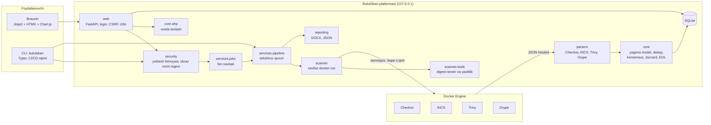
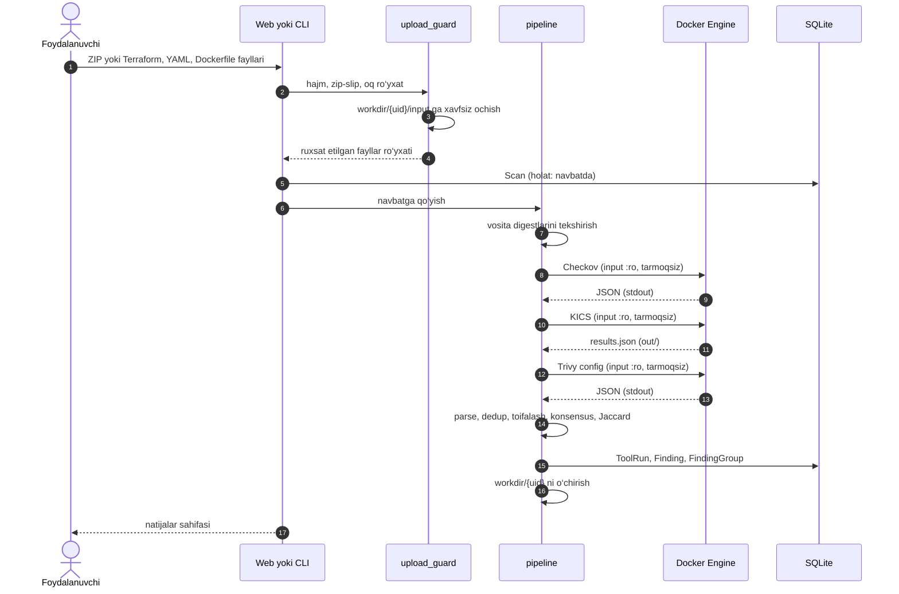
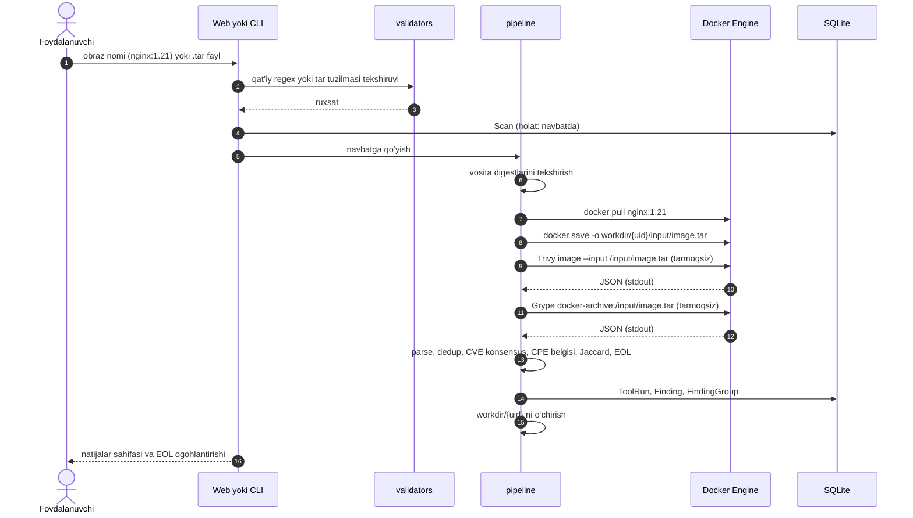
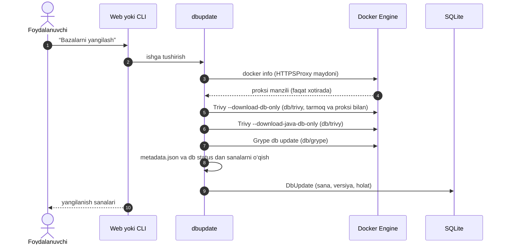
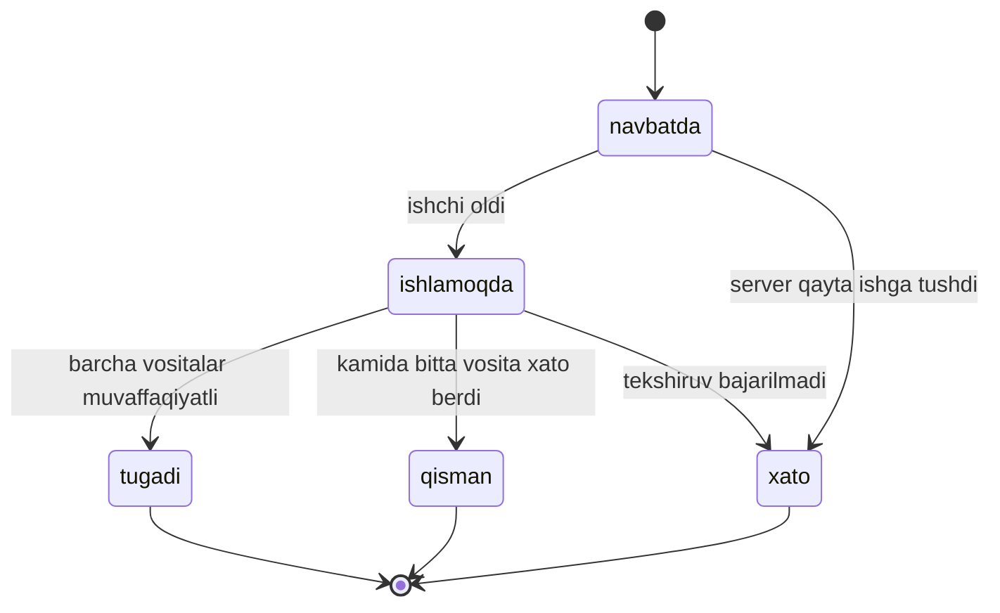
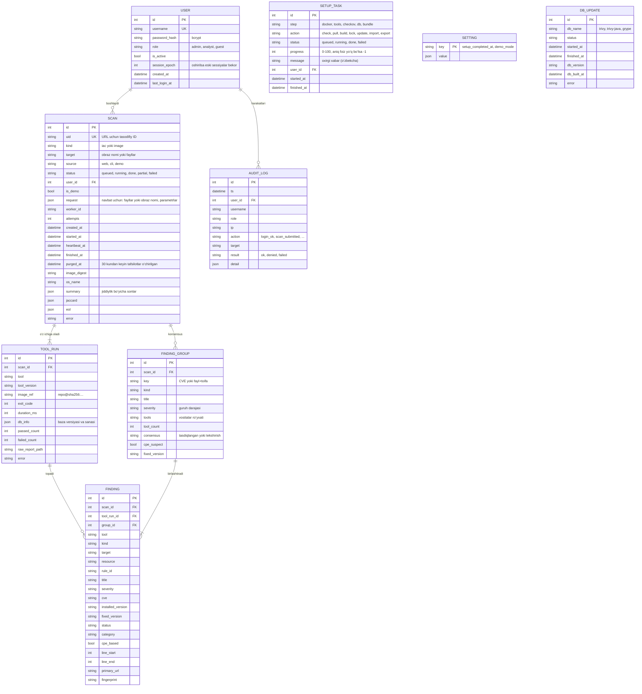
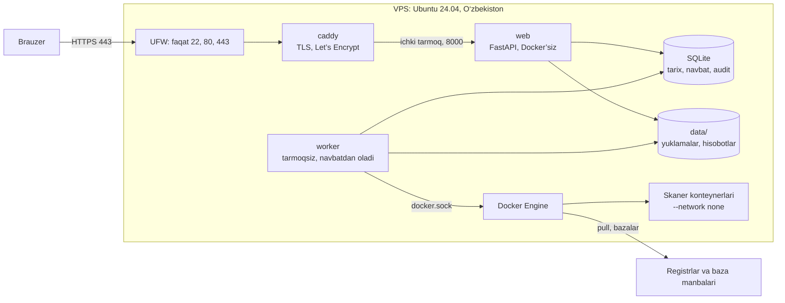
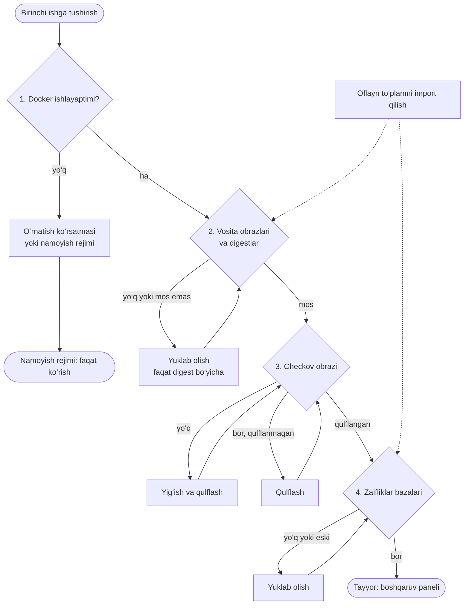
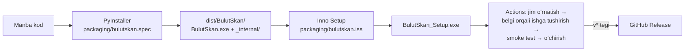

# BulutSkan arxitekturasi

> **Holat:** 3-bosqich bajarildi: xavfsiz skaner moduli, digest tekshiruvi, bazalarni yangilash, fayl yuklash himoyasi, tekshiruv quvuri va CLI ning asosiy buyruqlari. Haqiqiy Docker bilan sinov ko‘rsatmasi: [windows_sinov.md](windows_sinov.md).
> **Reja o‘zgarishi:** lokal rejimdan tashqari server rejimi qo‘shildi: internetdagi VPS, HTTPS, rollar, kvotalar, alohida `worker` (17-bo‘lim). Veb qismi 4-bosqichda ikkala rejimni hisobga olib quriladi, serverga joylashtirish alohida 8-bosqich.
> 1-bosqichda ⚠ bilan belgilangan joylar `Sinov` materiallari (`analyze.py`, `stats3.py`, `ground_truth.csv`, `run_tests.ps1`, `tool_digests.txt`, `ahp/`) asosida aniqlashtirildi.

BulutSkan — bulutli infratuzilma kodini (IaC) va konteyner obrazlarini bir nechta ochiq kodli skaner bilan tekshiradigan mahalliy veb-platforma. U Andijon davlat universiteti magistranti Odilova Robiyaxonning “Bulutli hisoblash texnologiyalari xavfsizligini ta’minlovchi dasturiy vositalarni qiyosiy tahlil qilish va ochiq kodli vositalar samaradorligini baholash” mavzusidagi dissertatsiyasining amaliy natijasidir.

## 1. Asosiy tamoyillar

Platformaning har bir qismi dissertatsiya xulosalaridan kelib chiqadigan beshta tamoyilga bo‘ysunadi:

1. **Bitta skanerga ishonilmaydi.** Har bir obyekt kamida ikkita vosita bilan tekshiriladi. Natijalar konsensus va Jaccard koeffitsienti orqali taqqoslanadi.
2. **Skaner — ishonchsiz kod.** Har bir vosita alohida, tarmoqsiz, imtiyozsiz va resurslari cheklangan konteynerda ishlaydi.
3. **Ta’minot zanjiri qotiriladi.** Vositalar teg orqali emas, faqat sha256 digest orqali chaqiriladi. Digest mos kelmasa, tekshiruv boshlanmaydi.
4. **Internet faqat bitta bosqichda kerak.** Zaifliklar bazalari alohida “bazalarni yangilash” amali bilan yuklanadi. Tekshiruvning o‘zi internetsiz bajariladi.
5. **Ma’lumotlar mahalliy qoladi.** Telemetriya, tashqi CDN va tashqi API yo‘q. Lokal rejimda ilova faqat `127.0.0.1` manzilida tinglaydi. Server rejimida u O‘zbekistondagi VPS’da faqat HTTPS orqali (Caddy) ochiq bo‘ladi, foydalanuvchi ma’lumotlari serverdan chiqmaydi (17-bo‘lim).

## 2. Umumiy ko‘rinish



Veb-interfeys va CLI bir xil `services.pipeline` quvurini chaqiradi. Shu sababli brauzer va CI/CD bir xil natija beradi.

Diagramma lokal rejimni ko‘rsatadi: veb va skaner bitta kompyuterda. Server rejimida veb va skanerlarni ishga tushiruvchi `worker` alohida jarayonlar. Ular faqat SQLite navbati orqali gaplashadi va Docker’ga faqat `worker` kiradi (17.2-bo‘lim).

## 3. Modullar

| Modul | Vazifasi | Bosqich |
|---|---|---|
| `bulutskan.config` | `.env` faylidan sozlamalarni o‘qish (pydantic-settings), kataloglar va limitlar | 2 |
| `bulutskan.core.models` | Yagona topilma modeli, jiddiylik va holat sanoqlari (enum) | 2 |
| `bulutskan.core.normalize` | Jiddiylik va holatni normallashtirish, GHSA → CVE (`stats3.py` asosida) | 2 |
| `bulutskan.core.dedup` | Bitta vosita ichidagi takroriy topilmalarni birlashtirish | 2 |
| `bulutskan.core.categories` | IaC xato toifalari: `ground_truth.csv` dagi regex qoidalari | 2 |
| `bulutskan.core.consensus` | Vositalararo guruhlash, “Tasdiqlangan” va boshqa belgilar, Jaccard | 2 |
| `bulutskan.core.eol` | Eskirgan bazaviy obrazni aniqlash | 2 |
| `bulutskan.core.ahp` | AHP vaznlari, ballar, ssenariylar, reyting | 2 |
| `bulutskan.core.gate` | `--fail-on` qarori, `--unknown-severity` siyosati | 3 |
| `bulutskan.parsers.*` | Checkov, KICS, Trivy (image va config), Grype JSON parserlari (`analyze.py` asosida) | 2 |
| `bulutskan.scanner.docker` | `docker` buyrug‘ini argumentlar ro‘yxati sifatida qurish va ishga tushirish | 3 |
| `bulutskan.scanner.runs` | Vosita natijasi, qabul qilinadigan chiqish kodlari, xato izohlari | 3 |
| `bulutskan.scanner.tools` | Vositalar reestri, digest yaxlitligini tekshirish | 3 |
| `bulutskan.scanner.iac`, `.image` | IaC va obraz tekshiruvi ssenariylari | 3 |
| `bulutskan.scanner.dbupdate` | Trivy, Trivy Java va Grype bazalarini yangilash | 3 |
| `bulutskan.security.*` | Yuklash himoyasi, vaqtinchalik katalog, obraz nomi regexi, bcrypt | 3–4 |
| `bulutskan.storage.*` | SQLAlchemy jadvallari va so‘rovlar | 4 |
| `bulutskan.services.*` | Tekshiruv quvuri, fon navbati, solishtirish, demo-import | 3–7 |
| `bulutskan.web.*` | FastAPI ilovasi, marshrutlar, shablonlar, statik fayllar | 4 |
| `bulutskan.reporting.json_export` | JSON eksport | 3 |
| `bulutskan.reporting.docx_report` | DOCX hisobot | 5 |
| `bulutskan.cli` | Typer buyruqlari: `scan`, `db-update`, `db-status`, `tools` (3), `demo-import`, `user`, `serve` (4–7) | 3–7 |

Kodda identifikatorlar ingliz tilida, izohlar va docstring’lar o‘zbek tilida yoziladi. Barcha funksiyalarda tur izohlari (type hints) bo‘ladi.

## 4. Papkalar tuzilmasi

Repozitoriy ildizi — `BulutSkan` loyihasining o‘zi. Windows’da u `D:\Dissertatsiyaga oid\Robiyaxon\BulutSkan` papkasiga klon qilinadi.

```text
BulutSkan/
├── bulutskan/
│   ├── __init__.py              # versiya
│   ├── __main__.py              # python -m bulutskan
│   ├── config.py                # Settings (.env)
│   ├── cli.py                   # Typer: scan, db-update, tools, demo-import, user, serve, worker
│   ├── worker.py                # navbatdan vazifa oluvchi jarayon (server rejimi)
│   ├── core/
│   │   ├── models.py            # Finding, Severity, FindingStatus, ToolReport, ScanResult
│   │   ├── normalize.py         # jiddiylik, holat, CVE normallashtirish
│   │   ├── dedup.py             # takrorlarni birlashtirish
│   │   ├── categories.py        # IaC toifalari (ground_truth.csv)
│   │   ├── consensus.py         # konsensus guruhlari, Jaccard
│   │   ├── eol.py               # EOL aniqlash
│   │   └── ahp.py               # AHP
│   ├── parsers/
│   │   ├── base.py              # umumiy interfeys, JSON ni xavfsiz o‘qish
│   │   ├── checkov.py
│   │   ├── kics.py
│   │   ├── trivy.py             # image (zaiflik) va config (noto‘g‘ri sozlama)
│   │   └── grype.py
│   ├── scanner/
│   │   ├── docker.py            # xavfsiz docker argumentlari, subprocess, timeout
│   │   ├── tools.py             # reestr va digest tekshiruvi
│   │   ├── iac.py
│   │   ├── image.py             # pull → save → internetsiz skan
│   │   └── dbupdate.py          # bazalarni yangilash, proksini aniqlash
│   ├── security/
│   │   ├── upload_guard.py      # hajm, zip-slip, oq ro‘yxat, tar tekshiruvi
│   │   ├── workspace.py         # tekshiruv uchun vaqtinchalik katalog
│   │   ├── validators.py        # obraz nomi regexi
│   │   └── passwords.py         # bcrypt
│   ├── storage/
│   │   ├── db.py                # engine, sessiya
│   │   ├── tables.py            # ORM jadvallari
│   │   └── repo.py              # saqlash va o‘qish
│   ├── services/
│   │   ├── pipeline.py          # parse → dedup → konsensus → EOL → saqlash
│   │   ├── jobs.py              # SQLite navbati: vazifa qo‘shish, atomar olish, yurak urishi
│   │   ├── quota.py             # kunlik kvota, tekshiruv oralig‘i, navbat limiti
│   │   ├── retention.py         # 30 kunlik saqlash muddati, tozalash
│   │   ├── audit.py             # audit jurnali
│   │   ├── compare.py           # ikki tekshiruvni solishtirish
│   │   ├── demo.py              # demo-import
│   │   ├── setup.py             # birinchi sozlash ustasining qadamlari va jarayon ko‘rsatkichi (8-bosqich)
│   │   └── bundle.py            # oflayn to‘plam: eksport va import (8-bosqich)
│   ├── reporting/
│   │   ├── docx_report.py
│   │   └── json_export.py
│   ├── resources/
│   │   ├── tool_digests.txt     # Sinov\natijalar dan nusxa
│   │   ├── checkov.Dockerfile   # Sinov dan nusxa
│   │   ├── ground_truth.csv     # Sinov dan nusxa
│   │   ├── ahp.json             # Sinov\ahp: matritsa A, xos vektor w
│   │   ├── ahp_upd.json         # Sinov\ahp: ballar S2, sezgirlik natijalari
│   │   ├── iac/                 # Sinov\iac: insecure va secure test fayllari
│   │   ├── tool_image_ids.txt   # vositalar obraz ID lari: oflayn to‘plamni tekshirish uchun (8-bosqich)
│   │   └── eol.json             # ichki EOL ro‘yxati
│   └── web/
│       ├── app.py               # FastAPI fabrikasi, middleware’lar
│       ├── auth.py              # login, sessiya, rollar, urinishlar cheklovi
│       ├── ratelimit.py         # so‘rovlar tezligi cheklovi
│       ├── headers.py           # CSP, HSTS va boshqa xavfsizlik sarlavhalari
│       ├── csrf.py
│       ├── i18n.py
│       ├── i18n/uz.json, en.json
│       ├── routes/              # dashboard, iac, image, scans, compare, ahp, tools, setup, help, admin
│       ├── templates/           # base.html, sahifalar, partials/
│       └── static/              # css/, js/, icons/, vendor/ (htmx, Chart.js)
├── demo/sinov/
│   ├── natijalar/               # Sinov\natijalar: real JSON hisobotlar (testlar va demo-import uchun)
│   │   └── tahlil/              # ch3.json, summary.json: testlar uchun kutilgan natijalar
│   └── skriptlar/               # asl skriptlar (analyze.py, stats3.py, run_tests.ps1 ...), faqat ma’lumot uchun
├── tests/
│   ├── conftest.py              # demo/sinov dagi hisobotlarni fixture sifatida yuklaydi
│   └── test_*.py
├── ci/
│   ├── github-actions.yml       # namuna
│   └── gitlab-ci.yml            # namuna
├── deploy/
│   ├── Dockerfile               # web va worker nishonlari (8-bosqich)
│   └── Caddyfile                # HTTPS, Let’s Encrypt (8-bosqich)
├── docs/
│   ├── arxitektura.md
│   ├── windows_sinov.md         # lokal rejimni haqiqiy Docker bilan sinash
│   ├── docker_ornatish.md       # Docker Desktop’ni o‘rnatish (usta shu sahifaga havola beradi)
│   └── serverga_joylash.md      # Ubuntu 24.04 serverni sozlash (8-bosqich)
├── pyproject.toml
├── requirements.txt
├── run.ps1                      # lokal rejim (Windows)
├── docker-compose.yml           # server rejimi: caddy, web, worker (8-bosqich)
├── .env.example
├── .gitignore
├── LICENSE                      # MIT
└── README.md
```

Ish vaqtida yaratiladigan barcha fayllar ildizdagi `data/` katalogiga tushadi va repozitoriyga kirmaydi:

```text
data/
├── bulutskan.db                 # SQLite
├── workdir/{scan_uid}/          # har tekshiruv uchun alohida, ish tugagach o‘chiriladi
│   ├── input/                   # yuklangan va ochilgan IaC fayllar yoki image.tar
│   └── out/                     # faqat KICS natija fayli uchun (7.4-bo‘limga qarang)
├── db/trivy/                    # Trivy asosiy va Java bazalari
├── db/grype/                    # Grype bazasi
└── hisobotlar/{scan_uid}/       # xom JSON hisobotlar, DOCX
```

`Sinov` papkasidagi fayllar o‘zgartirilmaydi. Kerakli fayllar repozitoriyga nusxa sifatida olinadi: platforma ishlashi uchun zarur kichik fayllar `bulutskan/resources/` ga, real hisobotlar (59 MB) `demo/sinov/natijalar/` ga. Hisobotlarning bitta nusxasi ham testlar, ham `demo-import` uchun xizmat qiladi. Har bir obraz uchun faqat `run1` olingan: uchta takror natijasi bir xil chiqqan.

## 5. Tekshiruv jarayonlari

### 5.1. IaC tekshiruvi



### 5.2. Konteyner obrazi tekshiruvi



Foydalanuvchi obrazi hech qachon `docker run` bilan ishga tushirilmaydi. U faqat yuklab olinadi va `.tar` arxivga saqlanadi. `.tar` fayl yuklanganda pull va save bosqichlari o‘tkazib yuboriladi.

Vositalar ketma-ket ishlaydi. Bir vaqtda faqat bitta skaner konteyneri ishlaydi, shuning uchun CPU va xotira limitlari kompyuterni band qilib qo‘ymaydi.

### 5.3. Bazalarni yangilash



Proksi manzili faqat shu bosqichda ishlatiladi. U faylga, bazaga va jurnalga yozilmaydi. Jurnalda faqat “proksi aniqlandi: ha/yo‘q” ko‘rinadi, chunki manzil ichida login va parol bo‘lishi mumkin.

Obrazni `docker pull` bilan yuklashda platforma proksi bermaydi. Bu ishni Docker Desktop o‘z sozlamalari bilan bajaradi.

### 5.4. Tekshiruv holatlari



“Qisman” holatida konsensus faqat ishlagan vositalar bo‘yicha hisoblanadi va natijalar sahifasida bu haqda ogohlantirish chiqadi.

## 6. Yagona topilma modeli

### 6.1. Maydonlar

Talab qilingan to‘qqizta maydonga konsensus, hisobot va solishtirish uchun kerakli yordamchi maydonlar qo‘shiladi.

| Maydon | Tur | Ma’nosi |
|---|---|---|
| `tool` | enum | Vosita: checkov, kics, trivy, grype |
| `target` | str | Fayl (IaC) yoki paket nomi (obraz) |
| `resource` | str \| None | Resurs (IaC) yoki paket joylashuvi (obraz) |
| `rule_id` | str | Qoida ID yoki zaiflik ID |
| `title` | str | Nomi |
| `severity` | enum | CRITICAL, HIGH, MEDIUM, LOW, INFO, UNKNOWN |
| `cve` | str \| None | Normallashtirilgan CVE |
| `fixed_version` | str \| None | Tuzatilgan versiya |
| `status` | enum | Holat (6.3-bo‘lim) |
| `kind` | enum | `vulnerability` yoki `misconfiguration` |
| `installed_version` | str \| None | O‘rnatilgan versiya |
| `package_type` | str \| None | deb, apk, npm, jar, binary va hokazo |
| `category` | str \| None | IaC xato toifasi (`ground_truth.csv`) |
| `cpe_based` | bool | Grype natijasi CPE yoki binar fayl orqali topilganmi |
| `line_start`, `line_end` | int \| None | IaC faylidagi qatorlar |
| `primary_url` | str \| None | Qoida yoki CVE havolasi |
| `fingerprint` | str | Takrorlarni aniqlash kaliti (6.4-bo‘lim) |

### 6.2. Manba maydonlari

Mantiq `analyze.py` va `stats3.py` dan ko‘chirilgan. Fayl yo‘llari vositalarda turlicha (Checkov `/iac/x.tf`, KICS `../../iac/x.tf`, Trivy `x.tf`), shuning uchun parserlar ularni tekshiruv ildiziga nisbatan bir xil yo‘lga keltiradi (`canonical_path`). Checkov uchun `file_abs_path` ishlatiladi. KICS uchun `search_key` va `resource_name` alohida saqlanadi: ground truth tokeni ikkalasida ham qidiriladi.

| Maydon | Checkov | KICS | Trivy config | Trivy image | Grype |
|---|---|---|---|---|---|
| `target` | `file_path` | `files[].file_name` | `Results[].Target` | `PkgName` | `artifact.name` |
| `resource` | `resource` | `files[].resource_name` / `search_key` | `CauseMetadata.Resource` | `PkgPath` yoki `Target` | `artifact.locations[].path` |
| `rule_id` | `check_id` | `query_id` | `ID` (AVD) | `VulnerabilityID` | `vulnerability.id` |
| `title` | `check_name` | `query_name` | `Title` | `Title` | `vulnerability.id` + tavsif |
| `severity` | `severity` (ko‘pincha `null`) | `severity` | `Severity` | `Severity` | `vulnerability.severity` |
| `cve` | — | — | — | `VulnerabilityID` | `id` yoki `relatedVulnerabilities[].id` |
| `fixed_version` | — | — | — | `FixedVersion` | `vulnerability.fix.versions[]` |
| `status` | `FAILED` | — | `Status` | `Status` | `vulnerability.fix.state` |
| qatorlar | `file_line_range` | `files[].line` | `CauseMetadata.StartLine/EndLine` | — | — |

### 6.3. Normallashtirish

Jiddiylik darajalari:

| Manba qiymati | Yagona qiymat |
|---|---|
| CRITICAL, Critical | CRITICAL |
| HIGH, High | HIGH |
| MEDIUM, Medium | MEDIUM |
| LOW, Low | LOW |
| Negligible (Grype) | LOW |
| INFO, TRACE (KICS) | INFO |
| `null`, Unknown, bo‘sh | UNKNOWN |

Grype’ning Negligible darajasi LOW ga tenglanadi. `analyze.py` ham uni LOW ustuniga qo‘shib sanaydi (`LOW + NEGLIGIBLE`).

Checkov’ning ochiq kodli versiyasi ko‘pincha `severity: null` qaytaradi. Platforma bu qiymatni to‘qib chiqarmaydi va UNKNOWN deb saqlaydi. Konsensus guruhida esa guruhning jiddiyligi a’zolarning ma’lum bo‘lgan eng yuqori darajasi bo‘ladi. Masalan, Checkov va KICS bir xatoni topsa, guruh KICS darajasini oladi. Bu daraja interfeysda “guruh bo‘yicha” deb belgilanadi.

Holat (`status`):

| Yagona qiymat | O‘zbekcha nomi | Manba |
|---|---|---|
| `fix_available` | Tuzatish mavjud | Trivy `fixed`, Grype `fixed` |
| `no_fix` | Tuzatish yo‘q | Trivy `affected`, Grype `not-fixed` |
| `wont_fix` | Tuzatilmaydi | Trivy `will_not_fix`, `fix_deferred`, Grype `wont-fix` |
| `unknown` | Noma’lum | qolgan holatlar |
| `failed` | Qoidaga zid | IaC: muvaffaqiyatsiz tekshiruvlar |

IaC bo‘yicha faqat muvaffaqiyatsiz tekshiruvlar topilma sifatida saqlanadi. O‘tgan tekshiruvlar soni `ToolRun` statistikasida qoladi.

CVE normallashtirish (`stats3.cve`): ID katta harfga keltiriladi. `CVE-` bilan boshlansa, o‘zi kalit bo‘ladi. Grype’da GHSA identifikatori `relatedVulnerabilities` ro‘yxatidagi birinchi CVE ga almashtiriladi. Trivy uchun faqat `VulnerabilityID` olinadi. CVE topilmasa, asl ID (GHSA, TEMP, DLA) kalit bo‘lib qoladi. Tuzatish mavjudligi Trivy’da `FixedVersion` bo‘sh emasligi, Grype’da `fix.state == "fixed"` bilan aniqlanadi.

### 6.4. Takrorlarni birlashtirish

Bir vosita bir topilmani bir necha marta qaytarishi mumkin. Masalan, Grype bitta paketni har bir joylashuvi uchun alohida ko‘rsatadi. Birlashtirish kaliti (`fingerprint`):

- zaiflik: `tool + cve_yoki_id + paket + o‘rnatilgan_versiya`;
- noto‘g‘ri sozlama: `tool + rule_id + fayl + resurs + boshlanish_qatori`.

Bir xil kalitli yozuvlar bitta topilmaga aylanadi, joylashuvlari esa ro‘yxat bo‘lib saqlanadi.

## 7. Konsensus mantiqi (asosiy ilmiy g‘oya)

### 7.1. Konteyner zaifliklari

1. Har bir vosita uchun normallashtirilgan CVE to‘plami tuziladi: `T` (Trivy) va `G` (Grype).
2. Har bir CVE uchun guruh (`FindingGroup`) ochiladi.
3. Belgilar:
   - CVE ikkala to‘plamda bor → **Tasdiqlangan**.
   - CVE faqat bitta to‘plamda → **Tekshirish talab etiladi**.
   - Grype topilmasida `vulnerability.namespace == "nvd:cpe"` yoki `artifact.type == "binary"` bo‘lsa → qo‘shimcha **“CPE asosida, soxta bo‘lishi mumkin”** belgisi.
4. CPE belgisi konsensus belgisini almashtirmaydi, unga qo‘shiladi. Faqat Grype CPE orqali topgan CVE ikki belgini oladi: “Tekshirish talab etiladi” va “CPE asosida, soxta bo‘lishi mumkin”.
5. Jaccard koeffitsienti:

$$J(T, G) = \frac{|T \cap G|}{|T \cup G|}$$

To‘plam elementi — obrazdagi normallashtirilgan CVE kaliti (paketsiz), `stats3.py` dagi kabi. Ikkala to‘plam bo‘sh bo‘lsa, `stats3.py` 1,0 qaytaradi; platforma ham shunday qiladi. Bir nechta obraz bo‘yicha umumiy koeffitsient `(obraz, CVE)` juftliklari to‘plamida hisoblanadi.

Qo‘shimcha ravishda **asosiy Jaccard** (`j_core`) ko‘rsatiladi. Unda Trivy’ning CVE bo‘lmagan ID lari va Grype’ning faqat CPE asosida topgan CVE lari chiqarib tashlanadi. III bobda bu ko‘rsatkich vositalar farqining qancha qismi metodologiyadan kelib chiqishini ko‘rsatadi.

Tekshirish: 15 ta obrazning barchasida `t_n`, `g_n`, `common`, `only_t`, `only_g`, `j`, `j_core`, `g_cpe`, `t_fix`, `g_fix`, kritik va yuqori darajalar `ch3.json` bilan bir xil chiqadi. Umumiy J = 0,767 (`test_consensus.py`).

### 7.2. IaC topilmalari

Turli vositalarning qoida ID lari bir-biriga to‘g‘ridan-to‘g‘ri mos kelmaydi. Checkov’da `CKV_AWS_20`, KICS’da UUID, Trivy’da `AVD-AWS-0086`. Shu sababli moslashtirish xato toifasi bo‘yicha bajariladi:

`ground_truth.csv` ning har bir qatori — bitta xato (40 ta: TF-01..TF-20, K8S-01..K8S-13, DF-01..DF-07). Qatorda xatoli va xavfsiz fayl, resurs tokeni (`tf02_bucket`), regex va istisno regexi bor. Regex `rule_id + " " + title` matniga (kichik harflarda) qo‘llanadi.

Platformada ikki rejim bor:

- **Ground truth bo‘yicha baholash** (`evaluate_ground_truth`). `analyze.py` ning IaC qismi aynan ko‘chirilgan: fayl, regex, istisno va resurs tokeni tekshiriladi, Terraform qatorlari blok nomiga bog‘lanadi. Natija — har bir vosita uchun TP, FP, recall, precision, F1 va juftliklar Jaccard’i. Namoyish fayllarida `summary.json` bilan to‘liq mos: Checkov 36/40, KICS 34/40, Trivy 32/40, Jaccard 0,842 / 0,838 / 0,784.
- **Ixtiyoriy fayllar uchun toifalash** (`categorize`). Foydalanuvchi faylida GT tokenlari yo‘q. Shu sababli fayl oilasi (Terraform, Kubernetes, Dockerfile) bo‘yicha xuddi shu regex va istisnolar qo‘llanadi. Tokenli qoidalar uchun token o‘rniga resurs turi tekshiriladi. Tur namoyish faylidan olinadi: `tf09_rds` → `aws_db_instance`, demak TF-10 (RDS shifrlash) faqat `aws_db_instance` bloklariga qo‘llanadi. Prefiks bo‘yicha solishtiriladi, shuning uchun `aws_s3_bucket` qoidasi `aws_s3_bucket_acl` ga ham tegadi. Bu rejim namoyish fayllarida ground truth bilan aynan bir xil toifalarni topadi (`test_categories.py`).

Konsensus:

1. Har bir topilmaga mos toifalar aniqlanadi. `Finding.category` ga birinchisi yoziladi.
2. Guruh kaliti: `fayl + toifa`. Bitta topilma bir nechta toifaga tushishi mumkin (`analyze.py` dagi kabi).
3. Kamida ikkita vosita topgan guruh → **Tasdiqlangan**. Bitta vosita topgani → **Tekshirish talab etiladi**.
4. Hech bir toifaga tushmagan topilma o‘z qoidasi bo‘yicha alohida guruhda qoladi va “Toifalanmagan” deb belgilanadi. U Jaccard hisobiga kirmaydi.
5. Jaccard: har bir vosita juftligi uchun (Checkov–KICS, Checkov–Trivy, KICS–Trivy) va uchala vosita uchun umumiy. Ikkala to‘plam bo‘sh bo‘lsa 0 (`analyze.py` dagi kabi):

$$J(A, B, C) = \frac{|A \cap B \cap C|}{|A \cup B \cup C|}$$

## 8. Eskirgan bazaviy obrazni aniqlash

Obraz quyidagi shartlardan biri bajarilsa eskirgan (EOL) hisoblanadi:

1. Trivy hisobotida `Metadata.OS.EOSL == true`.
2. Trivy `Metadata.OS` yoki Grype `distro` maydonidagi nom va versiya ichki ro‘yxatga tushadi.
3. Obraz nomi va tegi ichki ro‘yxatdagi runtime’ga mos keladi (masalan, `node:16-alpine`, `python:3.9-slim`).
4. Grype `binary` turidagi artefaktlarida `node` 16.x yoki `python` 3.9.x topilgan.

Ichki ro‘yxat (`resources/eol.json`):

| Nomi | Moslashtirish | Qo‘llab-quvvatlash tugagan sana |
|---|---|---|
| CentOS 7 | `centos` 7.* | 2024-06-30 |
| Ubuntu 20.04 | `ubuntu` 20.04 | 2025-05-31 (standart qo‘llab-quvvatlash) |
| Debian 11 | `debian` 11, 11.* | 2026-08-31 (LTS) |
| Alpine 3.18 | `alpine` 3.18.* | 2025-05-09 |
| Alpine 3.20 | `alpine` 3.20.* | 2026-04-01 |
| Node 16 | `node:16*`, binar `node` 16.* | 2023-09-11 |
| Python 3.9 | `python:3.9*`, binar `python` 3.9.* | 2025-10-31 |

EOL aniqlansa, natijalar sahifasining eng yuqorisida va DOCX hisobotda katta qizil ogohlantirish chiqadi:

> **Bazaviy obrazning qo‘llab-quvvatlash muddati tugagan. Skanerlar natijalari to‘liq emas, obrazni almashtiring.**

Ogohlantirish ostida qaysi manba (Trivy EOSL, Grype distro, ichki ro‘yxat) uni aniqlagani ko‘rsatiladi.

## 9. AHP vosita tanlash moduli

### 9.1. Mezonlar va vaznlar (II bob)

| Kod | Mezon | Vazn |
|---|---|---|
| K1 | Funksional qamrov | 0,1674 |
| K2 | Aniqlash sifati | 0,2888 |
| K3 | CI/CD integratsiyasi | 0,0570 |
| K4 | Moslashuvchanlik va me’yoriy xaritalash | 0,0570 |
| K5 | Iqtisodiy samaradorlik | 0,0952 |
| K6 | Ta’minot zanjiri xavfsizligi | 0,1674 |
| K7 | Normativ muvofiqlik va ma’lumotlar mahalliyligi | 0,1674 |

### 9.2. Ballar (1–5)

| Vosita | K1 | K2 | K3 | K4 | K5 | K6 | K7 |
|---|---|---|---|---|---|---|---|
| Trivy | 4 | 4 | 5 | 4 | 5 | 2 | 4 |
| Grype | 2 | 4 | 5 | 2 | 5 | 4 | 4 |
| Checkov | 3 | 4 | 5 | 5 | 5 | 3 | 4 |
| KICS | 3 | 4 | 5 | 4 | 5 | 1 | 4 |
| Prowler | 3 | 3 | 4 | 5 | 5 | 3 | 4 |
| Wiz | 5 | 3 | 4 | 5 | 1 | 3 | 2 |
| Cortex Cloud | 5 | 3 | 4 | 5 | 1 | 3 | 2 |
| MS Defender for Cloud | 4 | 3 | 3 | 4 | 3 | 3 | 2 |

### 9.3. Hisoblash

Vositaning umumiy bali:

$$S_j = \sum_{i=1}^{7} w_i \cdot a_{ij}$$

Ssenariyda har bir vazn ko‘paytiruvchiga ko‘paytiriladi va yig‘indisi 1 ga keltiriladi:

$$w_i' = \frac{w_i \cdot m_i}{\sum_k w_k \cdot m_k}$$

| Ssenariy | Ko‘paytiruvchilar |
|---|---|
| Bazaviy | hammasi 1 |
| Davlat tashkiloti | K6 × 2, K7 × 2 |
| Yirik korporativ | K1 × 2, K2 × 1,5, K5 × 0,3 |
| Kichik tashkilot | K5 × 3 |

Foydalanuvchi slayderlar bilan har bir vaznni 0 dan 1 gacha o‘zgartiradi. Vaznlar avtomatik normallashtiriladi, reyting jadval va Chart.js ustunli diagrammasida darhol yangilanadi (HTMX).

9.1-jadvaldagi vaznlar to‘rt xonagacha yaxlitlangan (yig‘indisi 1,0002). Hisobda ular emas, `resources/ahp.json` dagi `w` ishlatiladi: xos vektor usulida olingan aniq vaznlar, yig‘indisi 1,0. Ballar `resources/ahp_upd.json` dagi `S2` dan olinadi. Natija 3.9-jadvalga mos (3 xonagacha): Checkov 3,874; Trivy 3,817; Grype 3,704; Prowler 3,529; KICS 3,483; Wiz va Cortex Cloud 3,148; MS Defender for Cloud 3,057.

Modul `ahp.json` dagi juftlik taqqoslash matritsasidan (`A`) bosh xos vektorni daraja usuli bilan qayta hisoblaydi. U `w` bilan 10⁻¹⁵ aniqlikda mos keladi. Muvofiqlik: λ_max = 7,042; CI = 0,0070; CR = 0,0053 < 0,1.

Sezgirlik tahlili: har bir mezon vazni ×0,5 va ×1,5 ga o‘zgartiriladi. Yetakchilar ro‘yxati va “birinchi uchlik tarkibi o‘zgarmagan” holatlar soni (14 tadan 13 tasi) `ahp_upd.json` bilan bir xil.

## 10. Ma’lumotlar bazasi



Xom JSON hisobotlar bazaga emas, `data/hisobotlar/{scan_uid}/` katalogiga yoziladi. `TOOL_RUN.raw_report_path` shu faylni ko‘rsatadi. Ikki tekshiruvni solishtirish `FINDING_GROUP.key` bo‘yicha bajariladi: yangi, yo‘qolgan (tuzatilgan) va o‘zgarmagan topilmalar.

### 10.1. Fon navbati

Veb-so‘rov skanerni kutmaydi. Navbat — `SCAN` jadvalining o‘zi: veb `queued` holatidagi yozuv qo‘shadi, worker uni atomar `UPDATE … RETURNING` bilan oladi (17.3-bo‘lim). Natijalar sahifasi holatni HTMX bilan har 2 soniyada so‘raydi.

- **Lokal rejim:** worker `bulutskan serve` jarayoni ichidagi bitta oqim (slot).
- **Server rejimi:** worker alohida `bulutskan worker` jarayoni, 2 ta slot.

Worker qayta ishga tushganda yurak urishi to‘xtagan `running` vazifalar bir marta navbatga qaytariladi, eski `workdir` kataloglari tozalanadi (`purge_stale`). SQLite WAL rejimida va `busy_timeout` bilan ochiladi.

## 11. Xavfsizlik arxitekturasi

### 11.1. Tahdidlar va choralar

| Tahdid | Chora | Modul |
|---|---|---|
| Skaner yoki uning bazasi buzilgan (ta’minot zanjiri hujumi). Real misollar `config.ps1` da qayd etilgan: Trivy 0.69.4–0.69.6 zararli relizlari (CVE-2026-33634) va 2026-yil 22-aprelda KICS teglarining zararli obrazlarga almashtirilishi | Vosita faqat `repo@sha256:...` orqali chaqiriladi, ishga tushishda digest tekshiriladi, `--pull never` | `scanner.tools`, `scanner.docker` |
| Skaner ma’lumotni tashqariga yuboradi | `--network none`, telemetriya va yangilanish tekshiruvi bayroqlari o‘chiriladi | `scanner.docker` |
| Skaner xostni buzadi | `--read-only`, `--cap-drop ALL`, `no-new-privileges`, CPU/xotira/PID limitlari, `docker.sock` ulanmaydi | `scanner.docker` |
| Maxfiy ma’lumot konteynerga o‘tadi | Konteynerga faqat aniq qiymatli `--env` beriladi, xost muhiti uzatilmaydi, `--env-file` ishlatilmaydi | `scanner.docker` |
| Buyruq inyeksiyasi | `subprocess.run([...], shell=False)`, obraz nomi qat’iy regex, nom `-` bilan boshlanmaydi | `security.validators` |
| Zip-slip va zip-bomba | Yo‘llarni tekshirish, simvolik havolalarni rad etish, hajm va fayllar soni limiti, siqish nisbati limiti | `security.upload_guard` |
| Ruxsatsiz fayl turi | Kengaytma va fayl nomi bo‘yicha oq ro‘yxat, matn ekanini tekshirish (NUL bayt yo‘q) | `security.upload_guard` |
| Tekshiruvlararo ma’lumot sizishi | Har tekshiruvga alohida `workdir/{uid}`, `finally` blokida o‘chiriladi | `security.workspace` |
| Parol o‘g‘irlanishi | bcrypt xeshi, kirish urinishlari cheklovi (5 urinish / 5 daqiqa) | `security.passwords`, `web.auth` |
| CSRF | Sessiyaga bog‘langan token, har bir POST da `hmac.compare_digest` bilan tekshiriladi | `web.csrf` |
| XSS va clickjacking | Jinja2 autoescape, qat’iy CSP (`default-src 'self'`), `X-Frame-Options: DENY` | `web.app` |
| Tarmoqdan ruxsatsiz kirish | Sukut bo‘yicha `127.0.0.1`, boshqa manzil tanlansa ogohlantirish | `config`, `cli serve` |
| Ma’lumot O‘zbekistondan chiqishi | Tashqi CDN, shrift va telemetriya yo‘q, barcha JS/CSS `static/vendor` da | `web.static` |
| Proksi manzili oshkor bo‘lishi | Faqat xotirada, jurnalda yashiriladi, commit qilinmaydi | `scanner.dbupdate` |
| **Server rejimi:** parolni tanlab topish | Login va IP bo‘yicha cheklov, bcrypt, vaqtincha blok, audit | `web.auth`, `web.ratelimit` |
| **Server rejimi:** tekshiruvlar bilan resurslarni tugatish (DoS) | Kunlik kvota, tekshiruv oralig‘i, navbat limiti, 2 slot, konteyner limitlari, 2 GB obraz limiti, bo‘sh disk tekshiruvi | `services.quota`, `worker` |
| **Server rejimi:** obraz nomi orqali ichki tarmoqqa murojaat (SSRF) | Registrlar oq ro‘yxati; IP, `localhost` va ichki nomlar rad etiladi | `security.validators` |
| **Server rejimi:** veb ilova buzilsa, Docker orqali xostni egallash | `web` da Docker socket va CLI yo‘q; Docker’ga faqat tarmoqsiz, cheklangan `worker` kiradi | `deploy`, `worker` |
| **Server rejimi:** sessiyani o‘g‘irlash | `Secure`, `HttpOnly`, `SameSite=Strict`, HSTS, qisqa muddat, `session_epoch` | `web.auth`, `web.headers` |
| **Server rejimi:** foydalanuvchi ma’lumotlari uzoq saqlanishi | Yuklamalar darhol, hisobotlar 30 kunda o‘chiriladi | `services.retention` |

### 11.2. Skaner konteynerini ishga tushirish shabloni

Quyidagi shablon `scanner.docker` modulida argumentlar ro‘yxati sifatida quriladi:

```text
docker run --rm --pull never
  --name bulutskan-{uid}-{vosita}
  --network none
  --read-only
  --tmpfs /tmp:rw,nosuid,nodev,size=512m
  --cap-drop ALL
  --security-opt no-new-privileges
  --cpus 2 --memory 2g --memory-swap 2g --pids-limit 512
  --env HOME=/tmp
  (proksi o‘zgaruvchilari berilmaydi — pastdagi izohga qarang)
  --mount type=bind,source={workdir}/input,target=/scan,readonly        # IaC
  --mount type=bind,source={image.tar},target=/input/image.tar,readonly # obraz
  aquasec/trivy@sha256:{digest}
  {vosita argumentlari}
```

Izohlar:

- `--pull never` digest bo‘yicha obraz kompyuterda yo‘q bo‘lsa, Docker uni jimgina yuklab olishiga yo‘l qo‘ymaydi.
- **Tarmoqsiz konteynerga proksi o‘zgaruvchilari umuman berilmaydi, bo‘sh qiymat bilan ham.** Dastlabki rejada ular `HTTP_PROXY=` kabi bo‘sh qiymat bilan bekor qilinardi. Windows’dagi sinovda aynan shu Checkov’ni yiqitdi. Checkov 3.3.26 `os.environ['https_proxy']` ni o‘qiydi va faqat o‘zgaruvchi yo‘q bo‘lsa proksisiz ishlaydi (`platform_integration.py`, `setup_http_manager`). Bo‘sh yoki sxemasiz qiymat `urllib3.ProxyManager` ni `ProxySchemeUnknown` bilan yiqitadi, chiqish kodi 2. Bu Checkov 3.3.26 bilan qayta chiqarib tekshirildi: o‘zgaruvchisiz 102 ta topilma va 36/40, bo‘sh qiymat bilan esa 2 kodi. `run_tests.ps1` ham bu o‘zgaruvchilarni bermagan. Endi `build_run_command` tarmoqsiz konteynerga proksi o‘zgaruvchisi berilishini umuman rad etadi.
- Docker Desktop yoki `~/.docker/config.json` o‘z proksisini konteynerga qo‘shishi mumkin, platforma buni bekor qila olmaydi. `--network none` da bu manzil baribir ishlatilmaydi. Agar qo‘shilgan qiymat sxemasiz bo‘lsa va Checkov yiqilsa, xato matni buni tushuntiradi va uni Docker sozlamasida `http://` bilan yozishni maslahat beradi.
- `-v` o‘rniga `--mount` ishlatiladi: Windows yo‘lidagi `D:` ikki nuqtasi `-v` sintaksisini buzadi. Yo‘lda vergul yoki qo‘shtirnoq bo‘lsa, tekshiruv xato bilan to‘xtaydi.
- Konteynerga muhit o‘zgaruvchisi faqat `KALIT=qiymat` ko‘rinishida beriladi. `docker` jarayonining o‘ziga ham xost muhitidan faqat zarur o‘zgaruvchilar (`PATH`, `DOCKER_HOST`, Windows tizim o‘zgaruvchilari) o‘tadi.
- Timeout tugasa, konteyner `docker kill bulutskan-{uid}-{vosita}` bilan to‘xtatiladi. 137 chiqish kodi “xotira yetmadi” deb tushuntiriladi.
- Root bo‘lmagan foydalanuvchi (`--user`) hali yoqilmagan: uni Windows’dagi haqiqiy sinovdan keyin har bir vosita bilan alohida sinab ko‘ramiz.

Vositalarga xos argumentlar eksperimentdagi `run_tests.ps1` dan aynan olinadi. Shunday qilinsa, platforma III bobdagi natijalarni takrorlaydi:

| Vosita | Argumentlar | Qo‘shimcha ulanishlar |
|---|---|---|
| Trivy image | `image --cache-dir /tmp/trivy --skip-db-update --skip-java-db-update --offline-scan --scanners vuln --format json --input /input/image.tar` | `db/` → `/tmp/trivy/db` va `java-db/` → `/tmp/trivy/java-db`, ikkalasi faqat o‘qish uchun |
| Trivy config | `config --skip-check-update --format json /scan` | — |
| Grype | `docker-archive:/input/image.tar -o json`; muhit: `GRYPE_DB_CACHE_DIR=/cache`, `GRYPE_DB_AUTO_UPDATE=false`, `GRYPE_CHECK_FOR_APP_UPDATE=false`, `GRYPE_DB_VALIDATE_AGE`, `TMPDIR=/scratch` | baza → `/cache` faqat o‘qish uchun; `scratch/grype` → `/scratch` yozish uchun |
| Checkov | `-d /scan --skip-download --quiet -o json --output-file-path /out` | `out/checkov` → `/out` yozish uchun |
| KICS | `scan -p /scan -o /out --report-formats json --no-progress` | `out/kics` → `/out` yozish uchun |

Vositalar chiqish kodi: Checkov xato topsa 1, KICS eng yuqori daraja bo‘yicha 20–60 qaytaradi (eksperimentdagi `timings.csv` da ham shunday). Bu kodlar muvaffaqiyat deb qabul qilinadi.

**Yozish uchun ulanadigan kataloglar** — talabdagi “faqat tekshiriladigan fayllar `:ro`” qoidasidan uchta asosli istisno. Har biri bo‘sh holda ochiladi, faqat shu tekshiruvga tegishli va ish tugagach o‘chiriladi:

1. Checkov va KICS uchun `out/`: ular natijani faylga yozadi (eksperimentdagi kabi).
2. Grype uchun `scratch/grype`: Grype obraz qatlamlarini vaqtinchalik katalogga ochadi. Katta obrazlarda bu yuzlab megabayt, `tmpfs` esa konteyner xotirasidan joy oladi.
3. Baza nusxasi (zaxira rejim): vosita bazani faqat o‘qish rejimida ocha olmasa (`read-only file system` xatosi), baza `scratch/` ga nusxalanadi va bir marta qayta uriniladi. Asl baza baribir o‘zgarmaydi. `BULUTSKAN_TRIVY_DB_MODE=copy` bu rejimni doimiy qiladi.

### 11.3. Bazalarni yangilash konteyneri

Yagona farqlar: tarmoq yoqilgan (`bridge`), proksi `--env HTTPS_PROXY={docker info qiymati}` sifatida beriladi, baza katalogi yozish uchun ulanadi. `--read-only`, `--cap-drop ALL`, `no-new-privileges` va limitlar saqlanadi. Tekshiriladigan fayllar bu konteynerga ulanmaydi.

Buyruqlar (`run_tests.ps1` va `rerun_trivy.ps1` dan): `trivy image --cache-dir /cache --download-db-only`, `trivy image --cache-dir /cache --download-java-db-only`, `grype db update`. Keyin `grype db status` tarmoqsiz ishga tushiriladi. Sanalar `data/db/holat.json` ga yoziladi: platformaning yangilash vaqti, Trivy `metadata.json` (`UpdatedAt`, `NextUpdate`, `DownloadedAt`), Grype bazasi yig‘ilgan sana va sxemasi. Xato matnida proksi manzili uchrasa, `<proksi>` bilan almashtiriladi.

### 11.4. Digest yaxlitligi

1. `resources/tool_digests.txt` dan vosita → digest jadvali o‘qiladi. Format: `aquasec/trivy:0.76.1  ->  aquasec/trivy@sha256:...` (UTF-8, BOM bilan).
2. Ishga tushishda har bir vosita uchun `docker image inspect` bajariladi. Registrdagi obrazlar (Trivy, Grype, KICS) uchun `RepoDigests` ichida aynan shu digest bo‘lishi kerak.
3. Checkov registrdan olinmaydi: u `checkov.Dockerfile` dan mahalliy yig‘iladi va `tool_digests.txt` da digesti yo‘q (`checkov (pip) == 3.3.26`). Mahalliy yig‘ish takrorlanuvchan emas, shuning uchun birinchi yig‘ishda obraz `Id` si `data/tool_lock.json` ga yoziladi (birinchi ishonch tamoyili, trust on first use). Keyingi har ishga tushishda shu `Id` tekshiriladi va Checkov `sha256:{Id}` orqali chaqiriladi.
4. Natija:
   - **mos** — tekshiruvlar ruxsat etiladi;
   - **mos emas** — barcha tekshiruvlar bloklanadi, har bir sahifada qizil ogohlantirish chiqadi, CLI 2 kodi bilan chiqadi;
   - **obraz yo‘q** — tekshiruvlar bloklanadi, `bulutskan tools pull` buyrug‘i taklif qilinadi;
   - **Docker ishlamayapti** — faqat ko‘rish rejimi (tarix, demo ma’lumotlar, AHP).

### 11.5. Fayl yuklash himoyasi

| Tekshiruv | Sukut qiymati |
|---|---|
| Yuklanadigan IaC fayl yoki ZIP hajmi | 20 MB (oqim bo‘yicha sanaladi, `Content-Length` ga ishonilmaydi) |
| ZIP ochilgandagi umumiy hajm | 100 MB |
| ZIP dagi yozuvlar soni | 1000 |
| Siqish nisbati | 100:1 dan oshmasin |
| Obraz `.tar` hajmi | 4096 MB |
| Ruxsat etilgan fayllar | `.tf`, `.tfvars`, `.hcl`, `.yaml`, `.yml`, `.json`, `Dockerfile`, `Dockerfile.*`, `*.Dockerfile`, `Containerfile` |

ZIP yozuvi quyidagi hollarda butun arxiv rad etiladi: absolyut yo‘l, `..` qismi, Windows disk harfi, simvolik havola, shifrlangan yozuv, ichma-ich ZIP, Windows’da to‘qnashadigan nomlar (katta-kichik harf farqi). Har bir fayl ochilgach `Path.resolve()` natijasi `workdir/{uid}/input` ichida ekani yana tekshiriladi. Oq ro‘yxatga kirmaydigan oddiy fayllar o‘tkazib yuboriladi va natijalar sahifasida ro‘yxati ko‘rsatiladi.

Obraz `.tar` fayli xostda ochilmaydi. Faqat `tarfile` bilan tuzilmasi ko‘riladi: `manifest.json` (docker-archive) yoki `index.json` (oci-archive) borligi va yozuv nomlari xavfsizligi.

Obraz nomi regexi Docker havola grammatikasiga asoslanadi: `[registr[:port]/]nom[/nom...][:teg][@sha256:64_hex]`, uzunligi 255 belgigacha, kichik harflar, birinchi belgi harf yoki raqam.

## 12. Veb-interfeys

Jinja2 shablonlari serverda tayyorlanadi, HTMX qisman yangilanishlarni bajaradi. Chap tomonda menyu, asosiy qismda kartochkalar. Jiddiylik darajalari rang va SVG ikonka bilan belgilanadi: CRITICAL — to‘q qizil, HIGH — qizil-to‘q sariq, MEDIUM — sariq, LOW — ko‘k, INFO va UNKNOWN — kulrang. Pastki qismda doimiy yozuv: **“Ma’lumotlar O‘zbekiston hududidan chiqmaydi”**.

| Sahifa | Marshrut |
|---|---|
| Kirish / chiqish | `GET/POST /login`, `POST /logout` |
| Boshqaruv paneli | `GET /` |
| IaC tekshiruvi | `GET/POST /scan/iac` |
| Obraz tekshiruvi | `GET/POST /scan/image` |
| Tekshiruvlar tarixi | `GET /scans` |
| Natijalar | `GET /scans/{uid}`, `GET /scans/{uid}/status` (HTMX), `GET /scans/{uid}/findings` (HTMX filtr) |
| Eksport | `GET /scans/{uid}/report.docx`, `GET /scans/{uid}/export.json` |
| Solishtirish | `GET /scans/compare?a={uid}&b={uid}` |
| AHP | `GET /ahp`, `POST /ahp/calc` (HTMX) |
| Vositalar va bazalar | `GET /tools`, `POST /tools/db-update` |
| Til | `POST /lang/{uz\|en}` |

Boshqaruv paneli: jami tekshiruvlar, kritik topilmalar, tasdiqlangan topilmalar ulushi, oxirgi baza yangilanishi. Diagrammalar: vositalar bo‘yicha topilmalar, jiddiylik taqsimoti, vaqt bo‘yicha tekshiruvlar, tekshiruvlar kesimida Jaccard.

Tillar: o‘zbek (lotin, asosiy) va ingliz. Matnlar `web/i18n/uz.json` va `en.json` da, tanlangan til cookie’da saqlanadi.

Cookie: `HttpOnly`, `SameSite=Strict`, server rejimida `Secure`. Imzo kaliti `.env` dagi `BULUTSKAN_SECRET_KEY`. Ro‘yxatdan o‘tish sahifasi yo‘q: akkauntlar `bulutskan user add` bilan yaratiladi. Lokal rejimda `run.ps1` foydalanuvchi yo‘qligini ko‘rsa, buni o‘zi taklif qiladi.

Menyu foydalanuvchi roliga qarab chiqadi (17.4-bo‘lim). Administrator uchun qo‘shimcha sahifalar: `GET /admin/audit` (audit jurnali, filtr, CSV) va `GET /admin/users` (faqat ko‘rish, akkauntlar CLI’da boshqariladi). Tekshiruv sahifalarida foydalanuvchining qolgan kunlik kvotasi va navbatdagi o‘rni ko‘rsatiladi.

## 13. CLI

| Buyruq | Vazifasi |
|---|---|
| `bulutskan scan --iac ./infra --fail-on high` | IaC tekshiruvi |
| `bulutskan scan --image nginx:1.21 --fail-on critical --fixable-only` | Obraz tekshiruvi |
| `bulutskan scan --image-tar ./app.tar` | Tayyor `.tar` faylni tekshirish |
| `bulutskan db-update` | Zaifliklar bazalarini yangilash |
| `bulutskan db-status` | Bazalar sanalari |
| `bulutskan tools verify` | Digestlarni tekshirish |
| `bulutskan tools pull` | Trivy, Grype, KICS ni digest bo‘yicha yuklab olish |
| `bulutskan tools lock-checkov` | Mahalliy Checkov obrazi ID sini qulflash |
| `bulutskan tools build-checkov` | Checkov’ni `checkov.Dockerfile` dan yig‘ish |
| `bulutskan demo-import` | Namoyish ma’lumotlarini import qilish (Docker va internetsiz) |
| `bulutskan user add NOM --role admin\|analyst\|guest` | Akkaunt yaratish (faqat administrator, parol so‘raladi) |
| `bulutskan user list` / `user disable` / `user passwd` | Akkauntlarni ko‘rish, o‘chirish, parolni almashtirish |
| `bulutskan serve` | Veb-server. Lokal rejimda: 127.0.0.1:8000, worker ichida. Server rejimida: faqat veb, Docker’siz |
| `bulutskan worker` | Server rejimi: navbatdan tekshiruvlarni olib bajaruvchi jarayon (2 slot), kunlik tozalash va baza yangilash |
| `bulutskan setup` | Birinchi sozlash ustasining matnli varianti (18-bo‘lim, 8-bosqich) |
| `bulutskan bundle export FAYL` / `bundle import FAYL` | Oflayn to‘plam: vosita obrazlari va bazalar bitta arxivda (ixtiyoriy, 8-bosqich) |

Qo‘shimcha `scan` parametrlari: `--image-name` (`--image-tar` uchun obraz nomi, EOL tekshiruviga kerak), `--json natija.json`, `--unknown-severity`. `--docx` 5-bosqichda qo‘shiladi.

`--fail-on` chegarasi: jiddiyligi chegaradan past bo‘lmagan **konsensus guruhlari** sanaladi. Bir xatoni uchta vosita topgan bo‘lsa ham, u bir marta sanaladi. `--fixable-only` faqat tuzatilgan versiyasi bor zaifliklarni sanaydi. IaC uchun u e’tiborga olinmaydi va bu haqda eslatma chiqadi.

`--unknown-severity {ignore,low,medium,high}` (sukut: `medium`). Checkov’ning ochiq versiyasi jiddiylik bermaydi. Xatoni faqat Checkov topgan bo‘lsa, guruh darajasi UNKNOWN bo‘ladi va u hech qachon chegaraga yetmasdi. Namoyish fayllarida bunday xato bitta — TF-20 (HTTP listener). Unga 30 ta toifalanmagan Checkov topilmasi ham qo‘shiladi. Bu parametr faqat `--fail-on` qarorida ishlatiladi: ma’lumotda daraja `UNKNOWN` bo‘lib qoladi, hisobotda esa `noma’lum (CI uchun medium deb olindi)` deb yoziladi. JSON eksportda `severity`, `severity_ci` va `severity_label` maydonlari bor.

Chiqish kodlari:

| Kod | Ma’nosi |
|---|---|
| `0` | Chegaradan oshmadi (yoki `--fail-on` berilmagan) |
| `1` | `--fail-on` chegarasidan oshgan topilma bor |
| `2` | Foydalanish xatosi, vosita yaxlitligi buzilgan, tekshiruv bajarilmadi **yoki tekshiruv qisman** (biror vosita ishlamadi) |

**Qisman tekshiruv** sukut bo‘yicha 2 kodi bilan tugaydi: xavfsizlik tekshiruvi “xato bo‘lsa to‘xtatish” qoidasiga bo‘ysunadi. Busiz masalan Checkov yiqilsa, faqat u topadigan xatolar (namoyish fayllarida TF-20) konveyerdan jimgina o‘tib ketardi. Windows’dagi sinovda aynan shunday holat bo‘lgan. `--allow-partial` berilsa, qaror faqat ishlagan vositalar bo‘yicha qabul qilinadi (0 yoki 1). Ikkala holatda ham chiqish oxirida “Ishlamagan vositalar” bo‘limi chiqadi: vosita, sabab kodi (`timeout`, `out_of_memory`, `docker_error`, `proxy_scheme`, `missing_db`, `bad_report`, `exit_code`), chiqish kodi va tushuntirish. JSON eksportda bu `failures` ro‘yxatida, qaror esa `exit` obyektida (`code`, `reason`, `partial`, `allow_partial`) saqlanadi. DOCX hisobotda (5-bosqich) ham shu ma’lumot alohida bo‘lim bo‘ladi.

GitHub Actions va GitLab CI namunalari `ci/` katalogida turadi. Ular `.github/workflows/` ga qo‘yilmaydi, chunki repozitoriyning o‘zida ishga tushib ketmasligi kerak.

## 14. Hisobot

DOCX (python-docx, o‘zbek tilida):

1. Umumiy xulosa: obyekt, sana, holat, jami topilmalar, asosiy xavf.
2. Jiddiylik bo‘yicha jadval (vosita × daraja).
3. Konsensus: tasdiqlangan va tekshirish talab etiladigan guruhlar soni, CPE belgilari, Jaccard koeffitsientlari.
4. EOL ogohlantirishi (bo‘lsa).
5. Tuzatish tavsiyalari: zaifliklar uchun “paket → tuzatilgan versiya”, IaC uchun qoida havolasi va tavsiya.
6. Vosita versiyalari, digestlari va baza sanalari.

JSON eksport: `schema_version`, tekshiruv ma’lumotlari, vositalar (versiya, digest, baza sanasi), xulosa, konsensus guruhlari, Jaccard, EOL va barcha topilmalar.

## 15. Testlash strategiyasi

Barcha testlar Docker’siz o‘tadi. Docker chaqiruvlari `subprocess.run` ni almashtiradigan soxta ishga tushirgich (fake runner) bilan tekshiriladi.

Platforma Windows’da ishlatiladi, bulutli testlar esa Linux’da o‘tadi. Linux ochiq faylni o‘chirishga ruxsat beradi, Windows esa yo‘q (`PermissionError: [WinError 32]`). Shu farq tufayli bitta xato faqat Windows’dagi sinovda chiqqan edi. Endi `tests/winfs.py` barcha testlarda Windows qoidasini taqlid qiladi: test katalogidagi ochiq fayl ustida `unlink`, `remove`, `rmdir`, `rename` va `replace` xato beradi.

| Test fayli | Nimani tekshiradi | Ma’lumot |
|---|---|---|
| `test_parsers.py` | To‘rt vosita parserlari: yozuvlar soni, darajalar, tuzatiladiganlar `summary.json` bilan | `demo/sinov/natijalar` dagi real JSON |
| `test_normalize.py` | Jiddiylik, holat, GHSA → CVE, fayl yo‘llari | qo‘lda yozilgan misollar |
| `test_dedup.py` | Takrorlarni birlashtirish | real JSON va misollar |
| `test_consensus.py` | Belgilar, CPE belgisi, Jaccard: 15 obraz `ch3.json` bilan, IaC `summary.json` bilan | real JSON |
| `test_categories.py` | GT baholash `summary.json` bilan, ixtiyoriy fayllar uchun toifalash | `iac/run1` va `ground_truth.csv` |
| `test_eol.py` | EOL aniqlash | real Trivy/Grype JSON |
| `test_ahp.py` | 3.9-jadval, xos vektor, CR, sezgirlik tahlili | `ahp.json`, `ahp_upd.json` |
| `test_upload_guard.py` | Zip-slip, zip-bomba, simvolik havola, oq ro‘yxat, hajm, katalog o‘chirilishi | test ichida yaratiladigan arxivlar |
| `test_validators.py` | Obraz nomi regexi | to‘g‘ri va zararli nomlar |
| `test_docker_cmd.py` | Majburiy bayroqlar, `shell=False`, maxfiy muhit o‘zgaruvchilari yo‘qligi, `--mount` yo‘llari | `subprocess.run` almashtiriladi |
| `test_tools.py` | `tool_digests.txt`, digest holatlari (mos, mos emas, yo‘q, qulflanmagan), Checkov qulfi | `tests/fakes.py` (soxta docker) |
| `test_dbupdate.py` | Proksi aniqlash va yashirish, faqat shu bosqichda tarmoq, sanalar | soxta docker, eksperiment metadata fayllari |
| `test_scanner.py` | Butun quvur: buyruqlar xavfsizligi, natijalar `ch3.json`/`summary.json` bilan, zaxira rejim, xatolar, katalog o‘chirilishi | soxta docker + real JSON |
| `test_gate.py` | `--fail-on`, `--fixable-only`, `--unknown-severity`, hisobot yozuvi | real JSON |
| `test_cli.py` | Chiqish kodlari 0/1/2, `--unknown-severity`, JSON eksport, `tools`, `db-update` | soxta docker + real JSON |
| `test_windows_files.py` | Windows fayl qoidasi: ochiq faylni o‘chirish/ko‘chirish (WinError 32), qisman yozilgan fayllarni bekor qilish, katalogni qayta urinib o‘chirish | `tests/winfs.py` |
| `test_web.py` | Login, CSRF, ruxsatsiz kirish (4-bosqich) | FastAPI `TestClient` |

## 16. Texnologiyalar

| Qatlam | Tanlov |
|---|---|
| Til | Python 3.11+ |
| Backend | FastAPI, Starlette SessionMiddleware, Uvicorn |
| Ma’lumotlar | SQLAlchemy 2, SQLite |
| Model va sozlamalar | Pydantic 2, pydantic-settings |
| Shablonlar | Jinja2, HTMX 2 (loyiha ichida) |
| Diagrammalar | Chart.js 4 (loyiha ichida) |
| Xavfsizlik | bcrypt, itsdangerous |
| CLI | Typer |
| Hisobot | python-docx |
| Testlar | pytest, httpx |
| Skanerlar | Trivy 0.76.1, Grype v0.121.0, KICS v2.2.0, Checkov 3.3.26 (digest bo‘yicha) |
| Server rejimi | Ubuntu 24.04, Docker Engine va Compose, Caddy 2 (teskari proksi, Let’s Encrypt, digest bilan qotirilgan), UFW |

## 17. Ish rejimlari: lokal va server

Platforma bitta kod bazasidan ikki rejimda ishlaydi. Rejim `BULUTSKAN_MODE` sozlamasi bilan tanlanadi (`local` yoki `server`). Lokal rejim — dastlabki talab: Windows kompyuter, bitta foydalanuvchi, `127.0.0.1`. U o‘zgarishsiz qoladi. Server rejimi magistrlik himoyasi uchun qo‘shildi: komissiya platformani havola orqali ochadi.

### 17.1. Rejimlarni taqqoslash

| Xususiyat | Lokal (`local`) | Server (`server`) |
|---|---|---|
| Joy | Windows 11 kompyuter | O‘zbekistondagi VPS: Ubuntu 24.04, 4 vCPU, 8 GB RAM |
| Manzil | `http://127.0.0.1:8000` | `https://{domen}`, Caddy va Let’s Encrypt |
| Jarayonlar | Bitta: veb va ichki worker (1 slot) | Alohida konteynerlar: `caddy`, `web`, `worker` |
| Docker’ga kirish | Veb jarayoni (o‘z kompyuteri, bitta foydalanuvchi) | Faqat `worker`. `web` konteynerida Docker socket ham, Docker CLI ham yo‘q |
| Navbat | SQLite | SQLite. `web` va `worker` faqat shu orqali aloqa qiladi |
| Bir vaqtdagi tekshiruvlar | 1 | ko‘pi bilan 2 |
| Akkauntlar | `bulutskan user add` | Faqat administrator, `bulutskan user add`. Ro‘yxatdan o‘tish sahifasi yo‘q |
| Rollar | `admin` | `admin`, `analyst` (tahlilchi), `guest` (mehmon) |
| Tezlik cheklovi va kvota | Faqat kirish urinishlari | Kirish, so‘rovlar, tekshiruv yuborish, kunlik kvota (17.5-bo‘lim) |
| Obraz hajmi limiti | 4 GB | 2 GB |
| Cookie | `HttpOnly`, `SameSite=Strict` | Yana `Secure` |
| HSTS | Yo‘q (HTTP) | Bor |
| Hisobotlar saqlanishi | Cheklanmagan | 30 kun |
| Tortib olingan obraz | Docker keshida qoladi | Tekshiruvdan keyin `docker rmi` bilan o‘chiriladi |
| Bazalarni yangilash | Qo‘lda: `bulutskan db-update` | `worker` kuniga bir marta avtomatik; administrator qo‘lda ham yangilay oladi |

**“Ma’lumotlar O‘zbekiston hududidan chiqmaydi” yozuvi server rejimida ham to‘g‘ri qoladi.** Yuklangan fayllar, hisobotlar, akkauntlar va jurnallar VPS’dan chiqmaydi. Serverdan tashqariga faqat uch turdagi so‘rov ketadi, ularning hech birida foydalanuvchi ma’lumoti yo‘q:
1. Let’s Encrypt — sertifikat olish uchun faqat domen nomi;
2. konteyner registrlari — `docker pull` uchun obraz nomi;
3. Trivy va Grype bazalari manbalari — bazalarni yuklab olish.

### 17.2. Server rejimining tuzilmasi



Faqat `caddy` 80 va 443 portlarini ochadi. `web` faqat ichki Docker tarmog‘ida tinglaydi va tashqariga ochilmaydi. `worker` umuman tarmoqsiz (`network_mode: none`): u Docker Engine bilan unix socket orqali, `web` bilan esa SQLite fayli orqali gaplashadi.

### 17.3. `web` va `worker` ajratilishi

**`web`** so‘rovni qabul qiladi, foydalanuvchini va kvotani tekshiradi. Yuklangan fayllarni `security.upload_guard` bilan tekshiradi va ochadi: zip-slip, hajm, oq ro‘yxat, `.tar` tuzilmasi. Xato yuklama shu zahoti rad etiladi. So‘ng `SCAN` jadvaliga `queued` holatidagi yozuv qo‘shadi. `web` skaner modullarini (`bulutskan.scanner.docker`) import qilmaydi. Bu test bilan tekshiriladi, `web` obrazida esa Docker CLI o‘rnatilmagan.

**`worker`** (`bulutskan worker`) navbatdan vazifani atomar oladi:

```sql
UPDATE scans SET status = 'running', worker_id = ?, started_at = ?, heartbeat_at = ?
WHERE id = (SELECT id FROM scans WHERE status = 'queued' ORDER BY created_at LIMIT 1)
RETURNING id, uid;
```

Keyin 3-bosqichdagi quvurni bajaradi, natijani bazaga yozadi, yuklangan fayllar va `.tar` arxivini o‘chiradi. Slotlar soni `BULUTSKAN_WORKER_SLOTS=2`. Har slot 15 soniyada `heartbeat_at` ni yangilaydi. `worker` qayta ishga tushsa, yurak urishi to‘xtab qolgan `running` vazifalar bir marta navbatga qaytariladi, ikkinchi marta esa `failed` deb yopiladi.

**Nega Redis emas, SQLite.** Yuklama kichik: bir vaqtda ko‘pi bilan 2 ta tekshiruv. SQLite tarix bazasi bilan bir fayl: alohida xizmat kerak emas, zaxira nusxa — bitta fayl. Ikki konteyner bir xil faylni umumiy katalog orqali ochadi. WAL rejimi va `busy_timeout` bir xostdagi bir nechta jarayon uchun yetarli.

**Bir xil yo‘l bilan ulash.** `worker` Docker Engine’ga xost yo‘llarini beradi (`--mount source=...`). Shu sababli `data/` katalogi xostda va ikkala konteynerda **bir xil yo‘l** bilan ulanadi: `/srv/bulutskan/data`, `BULUTSKAN_DATA_DIR=/srv/bulutskan/data`.

**`docker.sock` xavfi.** Docker socket’iga kirish amalda xostda root huquqiga teng. Shuning uchun `worker` konteyneri qattiq cheklanadi:
- `network_mode: none`;
- `read_only: true`;
- `cap_drop: [ALL]`, `no-new-privileges`;
- root bo‘lmagan foydalanuvchi, faqat `docker` guruhi orqali kirish;
- tashqaridan keladigan ma’lumotni deyarli qayta ishlamaydi: ZIP va `.tar` ni `web` tekshirib bo‘lgan.

Undan kuchliroq variant — rootless Docker (17.10-bo‘lim, 1-savol).

### 17.4. Rollar va huquqlar

| Amal | `admin` | `analyst` | `guest` (mehmon) |
|---|---|---|---|
| Panel va tarix | Barcha tekshiruvlar | O‘zinikilari va namoyish | Namoyish va o‘zinikilari |
| AHP sahifasi | ✓ | ✓ | ✓ |
| IaC: fayl yoki ZIP yuklash | ✓ | ✓ | ✗ — faqat namoyish fayllari (`resources/iac`) |
| Obraz: ixtiyoriy nom | ✓ | ✓ | ✗ — faqat eksperimentdagi 15 obraz ro‘yxatidan |
| Obraz: `.tar` yuklash | ✓ | ✓ | ✗ |
| Kunlik kvota | Cheklanmagan | 20 | 3 |
| Eksport (JSON, DOCX) | ✓ | O‘z tekshiruvlari va namoyish | Namoyish va o‘zinikilari |
| Bazalarni yangilash | ✓ | ✗ | ✗ |
| Audit jurnali | ✓ | ✗ | ✗ |
| Akkauntlar | Faqat CLI orqali | ✗ | ✗ |

Akkauntlarni faqat administrator serverda CLI orqali yaratadi:

```bash
docker compose exec worker bulutskan user add robiyaxon --role analyst
docker compose exec worker bulutskan user add mehmon --role guest
docker compose exec worker bulutskan user list
docker compose exec worker bulutskan user disable mehmon
docker compose exec worker bulutskan user passwd robiyaxon
```

Parol ikki marta so‘raladi va ekranga chiqmaydi; uzunligi kamida 12 belgi, bcrypt bilan xeshlanadi. Birinchi administrator `.env` dagi `BULUTSKAN_ADMIN_USERNAME` va `BULUTSKAN_ADMIN_PASSWORD` dan birinchi ishga tushishda bir marta yaratiladi. Bazaga faqat bcrypt xeshi yoziladi. `.env` dagi parol keyin o‘zgartirilsa, bazadagi parol o‘zgarmaydi: uni `user passwd` almashtiradi.

### 17.5. Cheklovlar

| Cheklov | Sukut qiymati | Sozlama |
|---|---|---|
| Kirish urinishlari | Login va IP bo‘yicha 15 daqiqada 5 ta, keyin 15 daqiqa blok | `BULUTSKAN_LOGIN_ATTEMPTS`, `BULUTSKAN_LOGIN_WINDOW_MIN` |
| Umumiy so‘rovlar | IP bo‘yicha daqiqasiga 120 ta | `BULUTSKAN_RATE_LIMIT_PER_MIN` |
| Tekshiruv yuborish | Foydalanuvchi bo‘yicha 30 soniyada 1 ta | `BULUTSKAN_SCAN_MIN_INTERVAL_S` |
| Kunlik kvota | `analyst` 20, `guest` 3, `admin` cheklanmagan | `BULUTSKAN_QUOTA_ANALYST`, `BULUTSKAN_QUOTA_GUEST` |
| Navbat | Bir vaqtda 2 ta ishlaydi. Navbatda jami ko‘pi bilan 20 ta, bitta foydalanuvchidan 2 ta | `BULUTSKAN_WORKER_SLOTS`, `BULUTSKAN_QUEUE_MAX`, `BULUTSKAN_QUEUE_PER_USER` |
| Obraz hajmi | 2 GB: yuklangan `.tar` (oqim bo‘yicha sanaladi) va tortib olingan obraz (`docker image inspect` → `Size`) | `BULUTSKAN_MAX_IMAGE_TAR_MB=2048` |
| Bo‘sh disk | `docker pull` dan oldin kamida 10 GB | `BULUTSKAN_MIN_FREE_DISK_GB` |
| Skaner konteyneri | 1,5 CPU va 2 GB xotira: 2 slot × 2 GB = 4 GB, qolgani tizim, `web` va `caddy` uchun | `BULUTSKAN_CONTAINER_CPUS`, `BULUTSKAN_CONTAINER_MEMORY` |
| Registrlar | `docker.io`, `ghcr.io`, `quay.io`, `mcr.microsoft.com`, `public.ecr.aws`, `registry.gitlab.com`. IP manzil, `localhost` va ichki nomlar rad etiladi | `BULUTSKAN_ALLOWED_REGISTRIES` |

Kirish va so‘rovlar hisoblagichlari `web` jarayoni xotirasida saqlanadi (server rejimida bitta uvicorn jarayoni). Kvota va tekshiruv oralig‘i `SCAN` jadvalidan hisoblanadi, shuning uchun qayta ishga tushganda ham saqlanadi.

**Registrlar ro‘yxati SSRF dan himoya qiladi.** Busiz foydalanuvchi `10.0.0.5:5000/x` kabi nom kiritib, serverni ichki tarmoqdagi manzilga murojaat qildirishi mumkin edi.

**Ma’lum cheklov.** Obraz hajmi `docker pull` tugagandan keyin tekshiriladi, chunki Docker Engine obrazni avval to‘liq yuklab oladi. Juda katta obraz trafik va diskni band qiladi. Bunga qarshi: bo‘sh disk tekshiruvi, `pull` uchun vaqt limiti, kvota va registrlar ro‘yxati. 8-bosqichda manifestdagi qatlamlar hajmini `pull` dan oldin o‘qish varianti ko‘riladi: digest bilan qotirilgan `crane` konteyneri orqali.

### 17.6. HTTP xavfsizligi

| Sarlavha | Qiymat | Rejim |
|---|---|---|
| `Content-Security-Policy` | `default-src 'self'; script-src 'self'; style-src 'self'; img-src 'self' data:; object-src 'none'; base-uri 'self'; form-action 'self'; frame-ancestors 'none'` | Ikkalasi |
| `Strict-Transport-Security` | `max-age=31536000; includeSubDomains` | Server |
| `X-Frame-Options` | `DENY` | Ikkalasi |
| `X-Content-Type-Options` | `nosniff` | Ikkalasi |
| `Referrer-Policy` | `no-referrer` | Ikkalasi |
| `Permissions-Policy` | `camera=(), microphone=(), geolocation=()` | Ikkalasi |
| `Cross-Origin-Opener-Policy` | `same-origin` | Ikkalasi |
| `Cache-Control` | Kirishdan keyingi sahifalarda `no-store` | Ikkalasi |

Sarlavhalarni `web` qo‘yadi, shuning uchun ular testlarda tekshiriladi. Caddy `Server` sarlavhasini olib tashlaydi va so‘rov tanasini cheklaydi: `.tar` yuklash marshrutida 2 GB, qolganlarida 20 MB.

**Sessiya.**
- Cookie: `HttpOnly`, `SameSite=Strict`, server rejimida `Secure`.
- Muddat: mutlaq 8 soat, harakatsizlikda 30 daqiqa.
- Imzo kaliti: `BULUTSKAN_SECRET_KEY`, kamida 32 bayt, faqat serverdagi `.env` da.
- Har so‘rovda foydalanuvchi bazadan qayta o‘qiladi, shuning uchun `user disable` darhol ta’sir qiladi.
- Parol almashtirilganda yoki akkaunt o‘chirilganda `USER.session_epoch` oshadi va eski cookie’lar bekor bo‘ladi.

**Proksi orqasida.** uvicorn `--proxy-headers --forwarded-allow-ips` bilan ishga tushadi va faqat Caddy konteyneriga ishonadi. Audit va tezlik cheklovi uchun mijoz IP si shu yerdan olinadi.

**Ishga tushishdagi tekshiruvlar.** Server rejimida quyidagilardan biri bajarilmasa, ilova ishga tushmaydi:
- `SECRET_KEY` berilgan, kamida 32 bayt va `.env.example` dagi namunaga teng emas;
- `BULUTSKAN_PUBLIC_URL` `https://` bilan boshlanadi;
- `web` konteynerida `docker.sock` ko‘rinmaydi;
- administrator mavjud yoki uni yaratish uchun `.env` qiymatlari berilgan.

### 17.7. Ma’lumotlarni saqlash va o‘chirish

| Ma’lumot | Joyi | Qachon o‘chiriladi |
|---|---|---|
| Yuklangan IaC fayllari va ZIP | `data/uploads/{uid}` → `workdir/{uid}/input` | Tekshiruv tugashi bilan (xato bo‘lsa ham) |
| Yuklangan `.tar` va `docker save` arxivi | `workdir/{uid}/input/image.tar` | Tekshiruv tugashi bilan |
| Tortib olingan foydalanuvchi obrazi | Docker Engine | Tekshiruvdan keyin `docker rmi` (server) |
| Xom JSON hisobotlar, DOCX | `data/hisobotlar/{uid}` | 30 kundan keyin |
| Topilmalar (`FINDING`, `FINDING_GROUP`) | SQLite | 30 kundan keyin |
| `SCAN` qatori (kim, qachon, nima, xulosa sonlari) | SQLite | Audit uchun qoladi |
| Audit jurnali | SQLite `audit_log` | 365 kundan keyin |
| Namoyish tekshiruvlari | SQLite | O‘chirilmaydi |

Muddatlarni `BULUTSKAN_REPORT_RETENTION_DAYS=30` va `BULUTSKAN_AUDIT_RETENTION_DAYS=365` belgilaydi. Tozalashni `worker` kuniga bir marta bajaradi va jurnalga yozadi.

### 17.8. Kirish va audit jurnali

`AUDIT_LOG` har bir muhim amalni yozadi: vaqt (UTC), foydalanuvchi, rol, IP, amal, obyekt, natija (`ok`, `denied`, `failed`) va qo‘shimcha ma’lumot (JSON).

Amallar:
- **kirish:** `login_ok`, `login_failed`, `login_locked`, `logout`;
- **tekshiruv:** `scan_submitted`, `scan_started`, `scan_finished`, `scan_failed`, `scan_viewed`, `export_downloaded`;
- **cheklovlar:** `quota_exceeded`, `rate_limited`;
- **akkauntlar:** `user_added`, `user_disabled`, `password_changed`;
- **tizim:** `db_update`, `integrity_failed`, `retention_cleanup`.

Administrator jurnalni `/admin/audit` sahifasida filtrlar bilan ko‘radi va CSV ga eksport qiladi. Bundan tashqari `web` va `worker` JSON qatorlarini stdout ga yozadi (`docker compose logs`). Docker’ning `json-file` drayveri ularni hajm bo‘yicha aylantiradi. Parollar, tokenlar, proksi manzili va yuklangan fayllar mazmuni jurnalga yozilmaydi.

### 17.9. Serverga joylashtirish (8-bosqich)

Repozitoriyga qo‘shiladigan fayllar:

| Fayl | Mazmuni |
|---|---|
| `deploy/Dockerfile` | Ikki nishon: `web` (Docker CLI’siz) va `worker` (Docker CLI bilan). Ikkalasida root bo‘lmagan foydalanuvchi |
| `deploy/Caddyfile` | Domen, avtomatik HTTPS, so‘rov hajmi limitlari, `Server` sarlavhasini olib tashlash, kirish jurnali |
| `docker-compose.yml` | `caddy` (digest bilan qotirilgan), `web`, `worker`. Tarmoqlar, `/srv/bulutskan/data` bir xil yo‘l bilan, cheklovlar |
| `.env.example` | Server bo‘limi: `BULUTSKAN_MODE`, `BULUTSKAN_PUBLIC_URL`, domen, kvotalar. Maxfiy qiymatlar o‘rnida faqat namuna |
| `docs/serverga_joylash.md` | Ubuntu 24.04 ni noldan sozlash (o‘zbek tilida) |

`docs/serverga_joylash.md` mazmuni:
1. Tizimni yangilash, `unattended-upgrades`.
2. Alohida foydalanuvchi va SSH kalit bilan kirish: `PasswordAuthentication no`, `PermitRootLogin no`.
3. UFW: faqat 22, 80, 443. Docker e’lon qilingan (`ports:`) portlar uchun UFW qoidalarini chetlab o‘tadi. Shuning uchun `ports:` faqat `caddy` da bo‘ladi va bu alohida tekshiriladi.
4. Docker Engine’ni rasmiy repozitoriydan o‘rnatish, `data/` va `.env` uchun huquqlar (`chmod 600 .env`).
5. Domen DNS yozuvi, birinchi ishga tushirish, sertifikat olinganini tekshirish.
6. Vositalarni tayyorlash: `tools pull`, `build-checkov`, `lock-checkov`, `db-update`.
7. Birinchi administrator va mehmon akkaunti.
8. Yangilash tartibi: `git pull` → `docker compose build` → `docker compose up -d` → `tools verify`.
9. Zaxira nusxa: SQLite’ning onlayn nusxasi, `.env` va `tool_lock.json` har kuni server tashqarisiga shifrlangan holda. Qayta tiklashni sinab ko‘rish.

**Maxfiy qiymatlar.** `BULUTSKAN_SECRET_KEY` va `BULUTSKAN_ADMIN_PASSWORD` faqat serverdagi `/srv/bulutskan/.env` da saqlanadi (`chmod 600`). `.env` `.gitignore` da. `.env.example` da faqat namuna turadi, server rejimi esa namuna qiymat bilan ishga tushmaydi. Kalit yaratish: `openssl rand -base64 48`.

### 17.10. Ochiq savollar

| № | Savol | Tavsiyam |
|---|---|---|
| 1 | `worker` Docker’ga qanday kirsin? A — tizimdagi Docker socket, `worker` qattiq cheklangan. B — rootless Docker: skaner konteyneridan chiqib ketgan hujumchi ham root bo‘lmaydi, lekin Ubuntu 24.04’da AppArmor profili va cgroup delegatsiyasini sozlash kerak, aks holda `--cpus` va `--memory` limitlari ishlamaydi | A bilan boshlash, 8-bosqichda B ni VPS’da sinab ko‘rish va ishlasa o‘tish |
| 2 | Mehmon qanday skanerlay oladi? | Faqat namoyish IaC fayllari va eksperimentdagi 15 obraz, fayl yuklash yo‘q, kuniga 3 ta |
| 3 | 30 kundan keyin nima o‘chadi? | Hisobot fayllari va topilmalar. `SCAN` qatori (kim, qachon, nimani) audit uchun qoladi |
| 4 | VPS diski | Kamida 40 GB: bazalar ~3–4 GB, vosita obrazlari ~2 GB, 2 parallel tekshiruv × (2 GB obraz + 2 GB `.tar`), Docker keshi |

## 18. Birinchi sozlash ustasi va oflayn to‘plam

Platformani birinchi marta ochgan foydalanuvchi Docker, vosita obrazlari va bazalarni qo‘lda tekshirmasligi kerak. Buni “Birinchi sozlash” ustasi bajaradi. U ikkala rejimda ishlaydi: lokal rejimda — Docker Desktop, server rejimida — Docker Engine (faqat administrator uchun). Usta 8-bosqichda yoziladi va 4-bosqichdagi veb-interfeysga tayanadi.

### 18.1. Qadamlar



Qadamlar tartib bilan bajariladi: keyingi qadam faqat oldingisi yashil bo‘lgandan keyin ochiladi. Masalan, Docker’siz obraz yuklab bo‘lmaydi, Trivy obrazisiz esa uning bazasini. Har bir qadam kartochkasida holat belgisi, o‘zbekcha xabar, amal tugmasi, jarayon ko‘rsatkichi va tafsilotlar (versiya, digest, sana) bo‘ladi.

| № | Tekshiruv | Yashil | Qizil va amal |
|---|---|---|---|
| 1 | `docker version`: CLI bormi, server javob beryaptimi, konteynerlar turi `linux` mi, Docker’ga ajratilgan xotira | “Docker ishlayapti (27.3.1, Linux konteynerlari, 7,8 GB xotira)” | **CLI yo‘q:** “Docker Desktop topilmadi…” + **O‘rnatish ko‘rsatmasi** + **Namoyish rejimida davom etish**. **Server javob bermayapti:** “Docker Desktop o‘rnatilgan, lekin ishga tushirilmagan…” + **Qayta tekshirish** |
| 2 | `verify_tools`: KICS, Trivy, Grype digestlari (11.4-bo‘lim) | “Uchala vosita digest bo‘yicha mos” | **Yo‘q:** **Yuklab olish** (`docker pull repo@sha256:…`). **Teg boshqa obrazga ko‘rsatmoqda:** ogohlantirish va yuklab olish, baribir faqat digest bo‘yicha |
| 3 | Checkov: `diss-checkov:3.3.26` bormi, qulflanganmi, ichidagi versiya 3.3.26 mi | “Checkov qulflangan: sha256:…” | **Obraz yo‘q:** **Yig‘ish**, keyin avtomatik qulflash. **Bor, qulflanmagan:** **Qulflash** (versiyasi tarmoqsiz konteynerda tekshiriladi) |
| 4 | `database_status`: Trivy, Trivy Java, Grype bazalari va sanalari | “Bazalar yangi: Trivy 2026-11-24, Grype 2026-11-24” | **Yo‘q:** **Yuklab olish**. **Eski** (sariq, 18.3-bo‘lim): **Yangilash** |

Talabda yashil va qizil holat so‘ralgan. Ularga uchinchisi qo‘shildi: **sariq** — “ishlaydi, lekin e’tibor bering”. Masalan, baza eskirgan yoki Docker’ga 4 GB dan kam xotira ajratilgan. Holat faqat rang bilan emas, belgi (✓, ✗, !) va matn bilan ham ko‘rsatiladi: rangni ajrata olmaydigan foydalanuvchi ham tushunadi.

Barcha qadamlar yashil bo‘lsa, usta sozlash tugaganini (`SETTING.setup_completed_at`) yozadi va boshqaruv paneliga o‘tadi. Usta keyinroq “Vositalar va bazalar” sahifasidan qayta ochiladi. Lokal rejimda vositalar hali bir marta ham tekshirilmagan bo‘lsa (`SETTING.setup_state` yo‘q), administrator kirgandan keyin shu sahifa avtomatik ochiladi.

### 18.2. Docker bo‘lmasa

1-qadam qizil bo‘lsa, ikkita yo‘l taklif qilinadi:

1. **O‘rnatish ko‘rsatmasi** — ilova ichidagi o‘zbekcha sahifa (`/help/docker`, matni `docs/docker_ornatish.md` da). Unda WSL 2 ni yoqish, Docker Desktop’ni rasmiy saytdan o‘rnatish, Docker Desktop’da proksini kiritish va kamida 4 GB xotira ajratish tushuntiriladi. Rasmiy hujjatga havola ham beriladi. Sahifa internetsiz ochiladi, havolaga esa foydalanuvchining o‘zi o‘tadi.
2. **Namoyish rejimida davom etish** — `demo-import` bajariladi (Docker va internet kerak emas). Panel, tarix, eksperiment natijalari, konsensus va AHP to‘liq ishlaydi. Tekshiruv sahifalarida tushuntirish turadi: “Namoyish rejimi: Docker topilmagani uchun yangi tekshiruvlar o‘chirilgan”. Bu 11.4-bo‘limdagi “Docker ishlamayapti — faqat ko‘rish rejimi” qaroriga mos.

Server rejimida 1-qadam qizil bo‘lsa, bu joylashtirish xatosi. Usta `docs/serverga_joylash.md` ga havola beradi.

### 18.3. Jarayon ko‘rsatkichi

Uzoq amallarni (yuklab olish, yig‘ish, bazalar) veb jarayoni emas, `worker` bajaradi. Server rejimida `web` Docker’ga kira olmaydi, shuning uchun 1-qadamdagi oddiy tekshiruv ham `worker` orqali o‘tadi. Veb `SETUP_TASK` jadvaliga vazifa qo‘shadi. Worker uning holati, foizi va oxirgi xabarini yangilab turadi. Sahifa HTMX bilan har soniyada ko‘rsatkichni yangilaydi. Ko‘rsatkich HTML `<progress>` elementi bo‘lib, yonida foiz yoki matn turadi.

| Amal | Foiz qanday hisoblanadi |
|---|---|
| Obraz yuklab olish | `docker pull` chiqishidan: tugagan qatlamlar / jami qatlamlar (“KICS: 3/7 qatlam, 43%”) |
| Checkov’ni yig‘ish | `docker build --progress=plain` chiqishidan: bajarilgan bosqich / jami bosqich, oxirgi `pip` qatori |
| Bazalarni yuklab olish | Baza bo‘yicha 1/3, 2/3, 3/3. Har baza ichida aniq foiz yo‘q: o‘tgan vaqt va kesh katalogi hajmi ko‘rsatiladi (“Trivy Java bazasi: 312 MB, 01:45”) |
| Oflayn to‘plam | Fayllar bo‘yicha va baytlar bo‘yicha |

Vosita foizni bermaydigan joyda platforma uni to‘qib chiqarmaydi: aniq foiz o‘rniga harakatlanuvchi ko‘rsatkich va o‘tgan vaqt chiqadi.

**1.0 versiyada amalga oshirilgani.** Foiz qatlamlar bo‘yicha emas, amal ichidagi qadamlar bo‘yicha hisoblanadi: obrazlar — vosita bo‘yicha (1/3, 2/3, 3/3), bazalar — baza bo‘yicha (1/3, 2/3, 3/3). Checkov’ni yig‘ishda foiz yo‘q, shuning uchun harakatlanuvchi ko‘rsatkich chiqadi. Yig‘ish tugagach, qulflash bosqichida ko‘rsatkich 80% ni ko‘rsatadi. `docker pull` va `docker build` chiqishidan qatlam bo‘yicha foiz olish keyingi versiyaga qoldirildi.

Bazalar sanasi ham tekshiriladi. Grype 5 kundan (120 soat) eski bazani qabul qilmaydi, shuning uchun 4 kundan eski baza sariq bo‘ladi. 5 kundan eskisi qizil: “Grype bazasi 6 kun oldin yig‘ilgan va tekshiruvda ishlamaydi. Yangilang”.

**Internet kerak bo‘lgan amallar:** obraz yuklab olish, Checkov’ni yig‘ish, bazalar. `docker pull` proksini Docker Desktop sozlamasidan oladi, yig‘ish va bazalar esa uni `docker info` dan oladi (5.3-bo‘lim). Ulanish xatosi bo‘lsa, usta proksi sozlamasini tekshirishni maslahat beradi: Docker Desktop → Settings → Resources → Proxies.

**Xavfsizlik.**
- Ustaning amallari faqat administrator uchun, har bir POST CSRF token bilan himoyalangan.
- Har amal audit jurnaliga yoziladi: `setup_pull`, `setup_build`, `setup_lock`, `setup_db_update`, `demo_mode_enabled`, `bundle_import`.
- Obrazlar faqat digest bo‘yicha yuklanadi.
- Checkov faqat platforma ichidagi `checkov.Dockerfile` dan, qat’iy argumentlar bilan yig‘iladi. Foydalanuvchi kiritgan qiymat buyruqqa tushmaydi.
- Checkov’ning yangi yig‘ishlarida bazaviy obraz ham digest bilan qotiriladi: `python:3.12-slim@sha256:191083cd…`, `image_digests.txt` dan olinadi. Mavjud `diss-checkov:3.3.26` obrazi o‘zgarmaydi.

CLI’da xuddi shu qadamlar `bulutskan setup` buyrug‘i bilan matnli ko‘rinishda bajariladi. U serverda SSH orqali va grafik interfeyssiz kompyuterlarda kerak bo‘ladi.

### 18.4. Oflayn to‘plam (ixtiyoriy)

Internetsiz kompyuterda vosita obrazlari va bazalarni yuklab bo‘lmaydi. Oflayn to‘plam ularni internetli kompyuterdan bitta arxivda olib o‘tadi.

```text
bulutskan bundle export D:\oflayn_toplam_2026-11-25.tar
bulutskan bundle import E:\oflayn_toplam_2026-11-25.tar
```

Ustada ham shu amallar bor. Import 2-qadam va 4-qadamni birdaniga yashil qiladi.

Arxiv tarkibi:

| Fayl | Mazmuni |
|---|---|
| `manifest.json` | To‘plam versiyasi, yaratilgan vaqt (UTC), platforma versiyasi, protsessor arxitekturasi (`amd64`), Docker saqlash usuli, har bir vosita uchun `digest_ref` va obraz ID si, bazalar sanalari, har bir faylning SHA-256 qiymati |
| `images/{trivy,grype,kics,checkov}.tar` | `docker save` natijasi |
| `db/trivy.tar.gz`, `db/trivy-java.tar.gz`, `db/grype.tar.gz` | `data/db` dagi bazalar |

Taxminiy hajm 2–3 GB. Arxivga foydalanuvchi ma’lumotlari kirmaydi: `bulutskan.db`, yuklamalar, hisobotlar va `.env` qo‘shilmaydi. Arxivda faqat ochiq vosita obrazlari va ochiq bazalar bor, shuning uchun u shifrlanmaydi. Uning yaxlitligi esa qat’iy tekshiriladi.

**Import paytidagi tekshiruvlar:**
1. Tashqi `.tar` ning yozuvlari faqat kutilgan nomlardan iborat bo‘lishi kerak, ochilmasdan oldin tekshiriladi (11.5-bo‘lim).
2. Har bir faylning SHA-256 qiymati `manifest.json` bilan solishtiriladi. Import oxirida arxivning umumiy SHA-256 qiymati ekranga chiqadi: uni eksport qilgan kompyuterdagi qiymat bilan solishtirish mumkin.
3. `docker load` dan keyin har bir registr vositasining **obraz ID si** (konfiguratsiya digesti) repozitoriydagi qotirilgan qiymat bilan solishtiriladi. Bu qiymat `resources/tool_image_ids.txt` da, bir marta haqiqiy kompyuterdan olinadi. Mos kelmasa, import to‘xtaydi va yuklangan obraz o‘chiriladi.
4. Checkov mahalliy yig‘ilgan, shuning uchun uning ID si faqat to‘plamdan olinadi. U ekranda ko‘rsatiladi va foydalanuvchi tasdiqlagandan keyin qulflanadi (birinchi ishonch tamoyili, manba: `bundle`).
5. Bazalar avval vaqtinchalik katalogga xavfsiz ochiladi (`tarfile` ning `data` filtri: yo‘l va havolalar tekshiriladi), keyin eski baza o‘rniga qo‘yiladi. Ayni paytda tekshiruv ishlayotgan bo‘lsa, import rad etiladi. Windows’da ochiq fayllarni almashtirib bo‘lmaydi (`WinError 32`).

**Nega obraz ID si kerak.** 11.4-bo‘limdagi tekshiruv registr bergan manifest digestiga (`RepoDigests`) tayanadi. `docker load` esa bu yozuvni har doim ham qayta tiklamaydi. Shuning uchun yuklangan obraz uning mazmunidan olingan, repozitoriyda qotirilgan digest bilan tekshiriladi. Bu digestni Docker “obraz ID si” deb ko‘rsatadi. U nimadan olinishi Docker’ning saqlash usuliga bog‘liq:

- **klassik image store:** ID — konfiguratsiya faylining sha256 qiymati;
- **containerd image store** (Docker Desktop’ning yangi o‘rnatmalarida sukut bo‘yicha): ID — manifest yoki indeks digesti.

Ikkala holatda ham ID obraz mazmunidan hisoblanadi va qalbakilashtirib bo‘lmaydi. Lekin turli saqlash usulida turli qiymat chiqadi. Shu sababli `tool_image_ids.txt` ga saqlash usulining turi bilan birga **haqiqiy kompyuterda o‘lchangan** qiymatlar yoziladi, `manifest.json` da ham saqlash usuli qayd etiladi. Aniq usul Windows’dagi sinovdan keyin, foydalanuvchi kompyuteridagi `docker info` natijasi bo‘yicha belgilanadi. Oflayn rejimda vositalar shu `sha256:{ID}` orqali chaqiriladi, shunda “faqat digest orqali” tamoyili saqlanadi.

**Eski bazalar haqida.** Oflayn kompyuterdagi baza vaqt o‘tishi bilan eskiradi. Usta va har bir hisobot baza sanasini ko‘rsatadi. Grype’ning 5 kunlik chegarasidan o‘tgan bazani ishlatish uchun usta `BULUTSKAN_GRYPE_VALIDATE_AGE=false` sozlamasini aniq ogohlantirish bilan taklif qiladi: “Baza N kun eski, natijalar to‘liq bo‘lmaydi”. Bu ogohlantirish hisobotga ham yoziladi.

### 18.5. Testlar (8-bosqich)

Soxta docker (`tests/fakes.py`) bilan tekshiriladi:
- har bir qadamning har bir holati: Docker CLI yo‘q, server o‘chiq, ishlayapti; obraz yo‘q va yuklab olinganidan keyin yashil; teg boshqa obrazga ko‘rsatgan holat; Checkov yo‘q → yig‘ish → qulflash; baza yo‘q, eski, yangi;
- Docker bo‘lmaganda namoyish rejimiga o‘tish;
- `docker pull` va `docker build` chiqishidan foiz hisoblash (yozib olingan namunalar asosida);
- to‘plamni eksport va import qilish; buzilgan fayl (SHA-256), boshqa obraz ID si, xavfli yo‘lli arxiv va tekshiruv ishlayotgan paytdagi import rad etilishi;
- barcha testlar Windows fayl qoidasi (`tests/winfs.py`) bilan.

### 18.6. Windows o‘rnatuvchisi

Docker Desktop o‘rnatilgan Windows kompyuterda platforma Python va git’siz ishlashi kerak. Buning uchun GitHub Releases’da `BulutSkan_Setup.exe` tarqatiladi.



| Qism | Qaror |
|---|---|
| Yig‘ish | PyInstaller, `onedir` rejimi (`onefile` har ishga tushishda arxivni vaqtinchalik papkaga ochadi, bu sekin va antiviruslar uchun shubhali). Ichida: Python, kutubxonalar, shablonlar, statik fayllar, `resources/`, III bob hisobotlari (`demo/sinov/natijalar`) |
| Kirish nuqtasi | `bulutskan/launcher.py`: argumentsiz ishga tushirilsa — `serve`, argument bilan — oddiy CLI (`BulutSkan.exe scan …`) |
| Oyna | Konsol oynasi: unda manzil va jurnal ko‘rinadi; oynani yopish dasturni to‘xtatadi |
| O‘rnatish joyi | `%LOCALAPPDATA%\Programs\BulutSkan`, administrator huquqisiz (`PrivilegesRequired=lowest`) |
| Ma’lumotlar | `%LOCALAPPDATA%\BulutSkan\data` (`config.default_data_dir`). Dastur papkasidan alohida, shuning uchun yangilash va o‘chirish ularga tegmaydi |
| Sozlamalar | Ixtiyoriy `%LOCALAPPDATA%\BulutSkan\bulutskan.env` |
| Bitta nusxa | `data/instance.json` da port saqlanadi. Belgi ikkinchi marta bosilsa, `/health` dagi `instance` (ma’lumotlar katalogi xeshi) solishtiriladi va ishlab turgan nusxa brauzerda ochiladi. Ikkinchi server va ikkinchi worker ishga tushmaydi |
| Docker yo‘li | `PATH` dan; topilmasa `C:\Program Files\Docker\Docker\resources\bin\docker.exe` (Docker Desktop o‘rnatilgandan keyin kompyuter qayta yuklanmagan bo‘lishi mumkin) |
| Birinchi ishga tushirish | Brauzer → administrator yaratish (faqat loopback’dan) → kirish → sozlash ustasi. Namoyish ma’lumotlari fonda import qilinadi |
| Imzo | O‘rnatuvchi imzolanmagan: SmartScreen ogohlantiradi. Yaxlitlik `SHA256SUMS.txt` bilan tekshiriladi (`docs/windows_ornatish.md`) |
| Tekshiruv | `.github/workflows/build.yml`: testlar (Ubuntu, Windows) → yig‘ish → `/VERYSILENT` o‘rnatish → `user add --password-stdin` → ish stolidagi `.lnk` orqali ishga tushirish → `packaging/smoke_test.py` (`/health`, 16 ta namoyish tekshiruvi, kirish va CSRF, EOL, Jaccard, ground truth, AHP, JSON, DOCX, sarlavhalar) → ikkinchi ishga tushirish → o‘chirish (ma’lumotlar qolishi tekshiriladi) |

Actions’dagi Windows runner’da Docker Linux konteynerlari yo‘q. Shuning uchun haqiqiy skanerlash qadamlari faqat foydalanuvchi kompyuterida tekshiriladi (`docs/windows_ornatish.md`, 8-bo‘lim).

## 19. Qabul qilingan qarorlar

| № | Masala | Qaror |
|---|---|---|
| 1 | `ground_truth.csv` tuzilmasi va regex mantiqi | 7.2-bo‘lim: GT baholash va resurs turi bo‘yicha toifalash |
| 2 | `stats3.py`: Jaccard elementi, GHSA → CVE, bo‘sh to‘plam | 7.1-bo‘lim: CVE kaliti, `relatedVulnerabilities`, bo‘sh → 1,0 |
| 3 | Jiddiylik xaritasi (Negligible, Checkov `null`) | Negligible → LOW, `null` → UNKNOWN (6.3-bo‘lim) |
| 4 | `tool_digests.txt` va Checkov | 11.4-bo‘lim: Checkov uchun birinchi yig‘ishdagi `Id` qotiriladi |
| 5 | Vosita argumentlari | `run_tests.ps1` dagi argumentlar aynan (11.2-bo‘lim) |
| 6 | AHP vaznlari | `ahp.json` dagi aniq `w`, ballar `S2` (foydalanuvchi tasdiqlagan) |
| 7 | Digest mos kelmaganda | Tekshiruvlar bloklanadi, tarix, demo va AHP ishlaydi (foydalanuvchi tasdiqlagan) |
| 8 | KICS uchun yozish katalogi | Bo‘sh, alohida `out/` katalogi |
| 9 | `--unknown-severity` | Sukut `medium`, faqat `--fail-on` qarorida (foydalanuvchi so‘ragan) |
| 10 | Server rejimi | Lokal rejim saqlanadi. Server: Caddy + `web` + `worker`, rollar, kvotalar, audit, 30 kunlik saqlash (17-bo‘lim, foydalanuvchi so‘ragan) |
| 11 | Navbat | SQLite (`SCAN` jadvali), Redis emas (17.3-bo‘lim) |
| 12 | Birinchi sozlash ustasi | To‘rt qadam: Docker → vositalar → Checkov → bazalar. Uzoq amallarni worker bajaradi, holatlar yashil, sariq va qizil (18-bo‘lim, foydalanuvchi so‘ragan) |
| 13 | Oflayn to‘plam | SHA-256 va repozitoriyda qotirilgan obraz ID lari bilan tekshiriladi, foydalanuvchi ma’lumotlari kirmaydi (18.4-bo‘lim) |
| 14 | Qisman tekshiruv | CI rejimida chiqish kodi 2, istisno `--allow-partial`; sabab hisobotda va JSON’da (foydalanuvchi tasdiqlagan) |
| 15 | Tarqatish | Windows o‘rnatuvchisi (PyInstaller + Inno Setup), GitHub Actions’da yig‘iladi va tekshiriladi, `v*` tegida Release (18.6-bo‘lim, foydalanuvchi so‘ragan) |
| 16 | CLI hisobot | `--docx` tarixga yozmaydi (vaqtinchalik baza), `--save` natijani tarixga `cli` manbasi bilan yozadi |
| 17 | Shablonlarga ma’lumot | Diagramma ma’lumotlari `data-json` atributida: HTMX almashtirilgan qismdagi barcha `<script>` teglarini o‘chiradi, CSP esa inline skriptga ruxsat bermaydi |

## 20. Bosqichlar

1–7-bosqichlar va 8-bosqichdagi sozlash ustasining veb qismi bajarilgan. Windows o‘rnatuvchisi (9) 1.0 versiyada chiqdi. Serverga joylashtirish (8) va oflayn to‘plam hali qilinmagan.

| Bosqich | Natija |
|---|---|
| 1 | `docs/arxitektura.md`, `.gitignore`, `.env.example` |
| 2 | Parserlar, yagona model, konsensus, AHP va ularning testlari |
| 3 | Xavfsiz skaner ishga tushirgich, digest tekshiruvi, bazalarni yangilash, yuklash himoyasi, tekshiruv quvuri, CLI (`scan`, `db-update`, `db-status`, `tools`), `--unknown-severity`, Windows sinov ko‘rsatmasi |
| 4 | SQLite (tarix va navbat), `worker` (lokalda ichki, serverda alohida jarayon), akkauntlar va rollar (`user add`), tezlik cheklovi va kvotalar, xavfsizlik sarlavhalari va sessiya, audit jurnali, saqlash muddati. Veb-interfeys: kirish, panel, IaC va obraz tekshiruvi, natijalar, AHP, tarix, administrator sahifalari. Ikkala rejim ham testlanadi |
| 5 | DOCX hisobot, JSON eksport, CLI, CI namunalari |
| 6 | O‘zbekcha README, LICENSE (MIT) |
| 7 | `bulutskan demo-import`. Mehmon roli va panel unga tayanadi, shuning uchun 4-bosqich bilan birga yoziladi |
| 8 | Serverga joylashtirish: `deploy/Dockerfile`, `deploy/Caddyfile`, `docker-compose.yml`, server `.env.example`, `docs/serverga_joylash.md` (Ubuntu 24.04, UFW, SSH kalit, yangilash, zaxira nusxa). Birinchi sozlash ustasi (veb va `bulutskan setup`), `docs/docker_ornatish.md`. Ixtiyoriy: oflayn to‘plam (`bundle export/import`) |
| 9 | Windows o‘rnatuvchisi: `packaging/` (PyInstaller, Inno Setup, smoke test), `.github/workflows/build.yml`, `docs/windows_ornatish.md`, GitHub Release (18.6-bo‘lim) |
